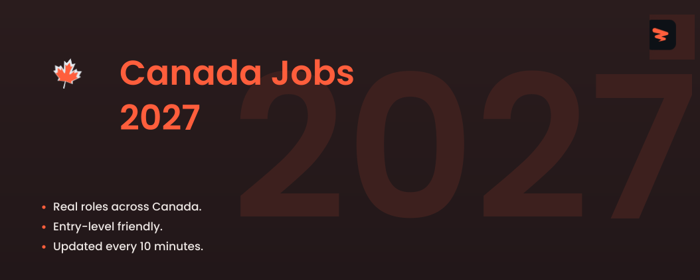

<!-- Cover -->

# Canada Jobs 2027

🚀 Entry-level, new-grad, and early-career jobs across Canada, sourced live and updated every 10 minutes.

  
  
  
  

---

## **Website & Autofill Extension**

Explore Zapply's website and check out:

- Our Chrome extension, which autofills job applications in seconds.
- A dedicated job board featuring the latest openings across various roles.
- User accounts with multiple profiles for different resume types and roles.
- Job application tracking with streaks and commitment awards.

Experience an advanced career journey with us! 🚀

  

## Explore Around

Connect and seek advice from a growing network of fellow students and new grads.

  
  &nbsp;&nbsp;
  

---

 

<h3>💻 <strong>Software Engineering</strong></h3>

| Company | Role | Location | Posted | Visa | **Apply** |
|---------|------|----------|--------|------|----------|
| **Citi** | Junior (Java) Developer | Mississauga Ontario Canada | 30m |  |  |
| **Citi** | Junior Developer (Java) | Mississauga Ontario Canada | 30m |  |  |
| **Cisco** | Software Developer I (Full Time) - Canada | Ottawa Ontario Canada +1 more | 31m |  |  |
| **Manulife** | Business Unit Security Officer | Waterloo Ontario +1 more | 1h |  |  |
| **CIBC** | Consultant - Application Developer | Toronto, ON | 1h |  |  |
| **CIBC** | Consultant, Full Stack Developer | Toronto, ON | 1h |  |  |
| **Altera** | Embedded Solutions Intern | Toronto | 1h |  |  |
| **TD Bank** | Software Engineer II (Salesforce Loyalty Management Developer) | Toronto | 2h |  |  |
| **TD Bank** | Information Security Specialist | Toronto | 2h |  |  |
| **Johnson Controls** | Technicien en sécurité / Field Security Technician CCTV & EAS | Ottawa-Ontario-Canada | 2h |  |  |
| **Sopra Steria** | System and Software Engineer - MBSE - Autmotive | Montréal, QC | 10h |  |  |
| **Cisco** | Software Developer | Ottawa | 1d |  |  |
| **Cisco** | Software Developer | Ottawa | 1d |  |  |
| **Microsoft** | Cloud Solution Architect - AI Apps - Full-time LOA backfill | Calgary, AB | 1d |  |  |
| **BMO** | Software Application Developer – Loan Servicing & AI Enablement | Toronto, ON | 1d |  |  |
| **Samsara** | Software Engineer II | Canada | 1d |  |  |
| **TD Bank** | Java Developer, TD Securities | Toronto | 1d |  |  |
| **Microsoft** | Cloud Solution Architect - Monitoring & Observability | Greater Toronto, ON | 1d |  |  |
| **Danaher** | Software Automation Test Developer -I | Concord | 2d |  |  |
| **BlackBerry** | BlackBerry Radar- Software Developer in Test | Ottawa | 4d |  |  |
| **Affirm** | Software Engineer I, Backend (Streaming Infra) | Canada | 4d |  |  |
| **Microsoft** | Software Engineer II - AI Engineering | Toronto, ON | 4d |  |  |
| **BMO** | Quality Engineer /SRE | Toronto, ON | 4d |  |  |
| **BMO** | AI Software Engineer | Toronto, ON | 4d |  |  |
| **Danaher** | Software Automation Test Developer -I | Concord | 4d |  |  |
| **CIBC** | Consultant, Information Security | Toronto, ON | 4d |  |  |
| **Affirm** | Software Engineer I, Fullstack (Disputes Platform) | Canada | 4d |  |  |
| **Teledyne** | Systems Engineer (II) | Canada - Waterloo, ON | 4d |  |  |
| **Capco** | Développeur logiciel backend | Canada - Montreal | 4d |  |  |
| **Capco** | Software Engineer, Implementation & Support | Canada - Toronto | 4d |  |  |
| **Citi** | Python/AI Developer | Mississauga Ontario Canada | 4d |  |  |
| **MongoDB** | Software Engineer 3 | Ontario, ON | 4d |  |  |
| **Apple** | Software Engineer, Productivity Apps | Vancouver | 5d |  |  |
| **NVIDIA** | Developer Relations Manager, Higher Education and Research - Foundational AI | Canada | 5d |  |  |
| **Lumentum** | Process Automation Software Engineer - MEMS | Canada - Ottawa | 5d |  |  |
| **Motorola Solutions** | Software Developer in Test II (Backend) | Vancouver | 5d |  |  |
| **Altera** | FPGA Software Engineer Intern | Toronto | 5d |  |  |
| **Amazon Development Centre Canada ULC** | Software Development Engineer , AWS CloudWatch | Vancouver, BC | 5d | ✅ Sponsor |  |
| **Analog Devices** | Engineer, Embedded Software | Canada | 5d |  |  |
| **Capco** | Backend Software Engineer | Canada - Toronto | 5d |  |  |
| **Apple** | Embedded OS Software Engineer, Separation Kernel, Core OS | Ottawa | 5d |  |  |
| **Sopra Steria** | Embedded Software Engineer - DO 178 | Montréal, QC | 5d |  |  |
| **Sopra Steria** | Systems Engineer – Defense C2 Integration & Deployment | Montréal, QC | 5d |  |  |
| **Apple** | Software Engineer, Developer Efficiency Platform | Vancouver | 5d |  |  |
| **Synechron** | Java Developer | Calgary, AB | 6d |  |  |
| **General Motors** | Business Analyst, Enterprise Data & Cloud Migration | Markham Ontario Canada +1 more | 6d |  |  |
| **ResMed** | Software Engineer | Halifax | 6d | ✅ Sponsor |  |
| **Ecolab** | Software Engineer | Calgary | 6d |  |  |
| **Roblox** | \[Summer 2027 Canada\] Software Engineer Intern, Engine | Vancouver, BC | 6d |  |  |
| **Lyft** | Android Software Developer, Lyft Urban Solutions | Montreal | 6d |  |  |
| **Capital One** | Associate, Software Engineer, New Grad Card Expansion | Toronto, ON | 6d |  |  |
| **Affirm** | Software Engineer II, Backend | Canada | 1w |  |  |
| **Salesforce** | Software Engineering MTS | Canada - Toronto | 1w |  |  |
| **Manulife** | Software Engineer, Banking Technology | Toronto | 1w |  |  |
| **Arondite** | Deployed Software Engineer (experienced) - Canada | Ottawa | 1w |  |  |
| **Fortinet** | Embedded Software Developer | Burnaby, BC | 1w |  |  |
| **Fortinet** | Embedded Software Developer | Burnaby, BC | 1w |  |  |
| **NTT Data** | .Net Full-Stack Developer (Remote Canada) | Burnaby, BC | 1w |  |  |
| **NTT Data** | OnBase API Developer - Remote Canada Position | Toronto, ON | 1w |  |  |
| **Motorola Solutions** | Software Engineer Co-op | Gatineau | 1w |  |  |
| **StackAdapt** | Software Engineer, Identity | Canada | 1w |  |  |
| **General Motors** | 2027 Winter Co-op Data Engineering Software Developer | Oshawa | 1w |  |  |
| **Fortinet** | Presales Security Expert Mid-Market | Montreal, QC | 1w |  |  |
| **Manulife** | Full Stack Software Engineer | Toronto | 1w |  |  |
| **Teledyne** | Windows Kernel Driver Developer - Image Acquisition Software | Canada Ottawa ON TDY +1 more | 1w |  |  |
| **Tailscale** | Developer Relations Engineer | Canada | 1w |  |  |
| **Sysco** | Software Engineer | Sysco Canada Inc. | 1w |  |  |
| **Cardinal Health** | JDE Systems Engineer | WFH, BC | 1w |  |  |
| **Canadian Tire** | Business Systems Engineer, AI | Toronto, ON | 1w | ✅ Sponsor |  |
| **Salesforce** | Platform and Security Growth Business Account Executive | Canada - Toronto | 1w |  |  |
| **Johnson Controls** | Technicien en sécurité / Field Security Technician CCTV & EAS | Quebec-Quebec-Canada | 1w |  |  |
| **1Password** | Security Engineer, Corporate Security | Remote | 1w |  |  |
| **Eaton** | Intern, Power Systems Engineering (4-12 month) - Milton, ON | Milton | 1w |  |  |
| **Eaton** | Intern, Power Systems Engineering (4-12 month) - Kitchener, ON | Kitchener | 1w |  |  |
| **Instacart** | Security Incident Manager | AB | 1w |  |  |
| **General Motors** | Software Developer- Simulation Tooling | Markham | 1w |  |  |
| **Stantec** | Physical Security Engineer | Longueuil, QC | 1w | ✅ Sponsor |  |
| **Kent Building Supplies** | Supply Chain Security Advisor | Dartmouth, NS | 1w |  |  |
| **PointClickCare** | Software Engineer | Mississauga | 1w |  |  |
| **Zip** | Software Engineer, Backend (All Levels) | Toronto | 1w |  |  |
| **Samsara** | Manager II, Software Engineering | Canada | 1w |  |  |
| **Amgen** | Undergraduate  Co-op Student – Software Engineer – Large Molecule Discovery - Technology | Canada - Burnaby | 2w |  |  |
| **Magnet Forensics** | Information Security Analyst Co-op (Winter 2027) | Waterloo / Ottawa / Ontario | 2w |  |  |
| **Okta** | Software Engineer II, Platform Infrastructure - Control | Toronto, ON | 2w | ✅ Sponsor |  |
| **iCapital Network** | Actuarial Software Engineer II - Associate | Toronto, ON | 2w |  |  |
| **1Password** | Security Engineer, GRC | Remote | 2w |  |  |
| **Hitachi** | DevOps Analyst Intern | Toronto | 2w |  |  |
| **NTT Data** | Oracle EBS Technical - Developer | Calgary, AB | 2w |  |  |
| **Cohere** | Software Engineer, ML Workload Platform | Remote | 2w |  |  |
| **DRW** | Software Developer | Montreal | 2w |  |  |
| **Asana** | Security Risk Engineer | Vancouver, BC | 2w |  |  |
| **Teledyne** | Software Engineering Coop | Canada - Waterloo, ON | 2w |  |  |
| **Qualcomm** | FY27 Intern - Telemetry Firmware, Driver and Tools Developer Internship - Canada (16 months) | Markham | 2w |  |  |
| **Arlo** | Firmware Developer Co-op | Richmond, BC | 3w |  |  |
| **Robinhood** | Software Engineer, Crypto Expansion | Toronto | 3w |  |  |
| **Qualcomm** | FY27 Intern - AI Software Engineering Co-op  - Canada (4 months) | Toronto | 3w |  |  |
| **Robinhood** | Applications Developer, Workday | Toronto | 3w |  |  |
| **MaintainX** | Integrations Developer | Toronto | 3w |  |  |
| **MaintainX** | Integrations Developer | Montreal | 3w |  |  |
| **MaintainX** | Full-Stack Developer - IAM | Montreal +1 more | 3w |  |  |

Apply for more jobs at

<h3>⚙️ <strong>Hardware & Systems</strong></h3>

| Company | Role | Location | Posted | Visa | **Apply** |
|---------|------|----------|--------|------|----------|
| **Thermo Fisher Scientific** | Validation Engineering Specialist III - Equipment Engineering | Mississauga | 53m |  |  |
| **Veolia Environnement SA** | Data Center Electrical Commissioning - Project Engineer | Toronto, ON | 6h |  |  |
| **Intel** | Graphics Hardware Validation Undergraduate Engineering Intern | Canada | 1d |  |  |
| **Kent Building Supplies** | Electrical & Instrumentation Tradesperson | Saint John, NB | 2d |  |  |
| **Kent Building Supplies** | Sales Associate - Plumbing/Electrical/Paint | Fredericton, NB | 2d |  |  |
| **Microsoft** | Ingénieur(e) électrique de centres de données /Data Center Electrical Engineer | Quebec City, QC | 4d |  |  |
| **NVIDIA** | ASIC Verification Intern - Summer 2027 | Canada | 5d |  |  |
| **Stantec** | Electrical EIT- Water | Edmonton, AB | 5d | ✅ Sponsor |  |
| **WSP** | Electrical Technician - North of QC | Rouyn-Noranda, QC | 5d | ✅ Sponsor |  |
| **Kent Building Supplies** | Department Manager - Lighting/Electrical/Plumbing | Mount Pearl, NL | 5d |  |  |
| **General Motors** | Data Validation & Quality Analyst | Markham Ontario Canada +1 more | 6d |  |  |
| **Stantec** | Intermediate Electrical, Instrumentation and Controls Engineer- Water | Toronto, ON | 6d | ✅ Sponsor |  |
| **Nokia** | HW Test Engineer | Canada | 1w | ✅ Sponsor |  |
| **WSP** | Electrical BIM Modeller | Victoria, BC | 1w | ✅ Sponsor |  |
| **Generac** | Associate Hardware Engineer | Toronto | 1w |  |  |
| **Johnson Controls** | Ingénieur Électrique / Electrical Engineer | Trois-Rivieres - Quebec - Canada | 1w |  |  |
| **Moog** | Electrical Engineer | Halifax, NS | 1w |  |  |
| **Stantec** | Electrical Engineering Student – Water (Summer 2027) | Burnaby, BC | 1w | ✅ Sponsor |  |
| **Danaher** | Hardware Engineering Co-op | Concord | 1w |  |  |
| **WSP** | Electrical Designer | Thornhill, ON | 1w | ✅ Sponsor |  |
| **Marvell** | Data Center Silicon Hardware Engineering Intern - BS - 2027 Co-Op | Ottawa Canada +1 more | 1w |  |  |
| **Ecolab** | Electrical Assembler | Calgary | 1w |  |  |
| **Johnson Controls** | Electrical Apprentice 3rd or 4th | Nisku-Alberta-Canada | 1w |  |  |
| **Johnson Controls** | QC Inspector - Electrical - Weekend Nights | Nisku-Alberta-Canada | 1w |  |  |
| **Veolia Environnement SA** | Electrical & Instrumentation Engineer - Water Technologies | Oakville, ON | 1w |  |  |
| **Veolia Environnement SA** | Associate Electrical, Instrumentation & Controls Engineer - Water Technologies | Oakville, ON | 1w |  |  |
| **Ecolab** | Electrical Engineering Co-Op | Calgary | 2w |  |  |
| **Altera** | FPGA Design Verification Intern | Toronto | 2w |  |  |
| **Qualcomm** | FY27 Intern - Software Validation Engineering Internship - Canada (16 months) | Markham | 2w |  |  |
| **Arlo** | Hardware Engineer Co-op | Richmond, BC | 3w |  |  |
| **Qualcomm** | FY27 Intern - Display IP FPGA Emulation Intern - Canada (4 months) | Markham | 3w |  |  |
| **Qualcomm** | FY27 Intern - Camera HW ASIC Verification Intern - Canada (12 or 16 months) | Vancouver | 3w |  |  |
| **Semtech** | Validation Engineering Intern | CAN - Ottawa, ON | 1mo |  |  |
| **Danaher** | Hardware Engineering Co-op | Concord | 1mo |  |  |
| **Marvell** | IC Validation Engineer Intern - BS/MS - 2027 Co-Op | Ottawa | 1mo |  |  |
| **Lumentum** | Electrical Engineer Co-op/Intern | Canada - Ottawa | 1mo |  |  |
| **Thermo Fisher Scientific** | Validation Engineering Co-op | Mississauga | 1mo |  |  |
| **Hitachi** | Electrical Component Engineering Intern (Summer 2027, 16months) | Toronto | 1mo |  |  |
| **Hitachi** | Hardware Test Engineering Intern (Summer 2027, 16months) | Toronto | 1mo |  |  |
| **Hitachi** | Electrical Component Engineering Intern (Fall 2026 or Winter 2027) | Toronto | 1mo |  |  |
| **Rocket Lab** | Electrical Engineering Intern Summer 2027 | Toronto | 2026-09-09 |  |  |

Apply for more jobs at

<h3>🔬 <strong>Data Science & Analytics</strong></h3>

| Company | Role | Location | Posted | Visa | **Apply** |
|---------|------|----------|--------|------|----------|
| **BMO** | Actuarial Analyst, Illustration Calculations (2 year contract) | Toronto, ON | 40m |  |  |
| **BMO** | Commercial Banking Rotational Internship (Office of Chief Data & Analytics, Business Enablement... | Toronto, ON | 40m |  |  |
| **TD Bank** | Data Scientist II | Toronto | 2h |  |  |
| **CIBC** | Consultant, Business Analytics | Toronto, ON | 1d |  |  |
| **Ciena** | Global Trade Data Analyst | Canada | 1d |  |  |
| **TD Bank** | Applied Machine Learning Scientist II | Toronto | 1d |  |  |
| **TD Bank** | Manager, Analytics and Insights | Markham | 1d |  |  |
| **Amazon Development Centre Canada ULC** | Machine Learning Engineer | Toronto, ON | 2d | ✅ Sponsor |  |
| **Qualcomm** | Machine Learning Framework, Compiler & Performance Engineer | Markham | 2d |  |  |
| **CIBC** | Consultant, Risk Analytics | Toronto, ON | 4d |  |  |
| **CIBC** | Consultant, Forecasting and Analytics | Toronto | 5d |  |  |
| **BMO** | Data Scientist, BMO Insurance | Toronto, ON | 1w |  |  |
| **Qualcomm** | FY27 Intern - AI/Machine Learning Internship Internship - Canada (16 months) | Markham | 1w |  |  |
| **Northeastern University** | Part Time Lecturer - Analytics (Vancouver) | Vancouver, BC | 1w |  |  |
| **Manulife** | Associate Machine Learning Engineer | Toronto | 1w |  |  |
| **Capital One** | Intern, Strategy Analyst - Summer 2027 | Toronto, ON | 1w |  |  |
| **Manulife** | Summer Intern 2027 - Strategy Analyst | Toronto | 1w |  |  |
| **Stripe** | Manager, Marketing Analytics | Toronto | 2w | ✅ Sponsor |  |
| **Stripe** | PhD Machine Learning Engineer, Intern | Toronto | 3w | ✅ Sponsor |  |
| **Stripe** | Master's Machine Learning Engineer, Intern | Toronto | 3w | ✅ Sponsor |  |
| **ShyftLabs** | Forward - Data Visualization & Analytics Specialist | Toronto | 3w |  |  |
| **Manulife** | Operations & Data Analyst Co-op (8 Months) | Waterloo Ontario +1 more | 3w |  |  |
| **Kent Building Supplies** | Data Analyst Student – Winter 2027 | Saint John, NB | 4w |  |  |
| **Trimble** | Firmware & Machine Learning Engineering Intern (16 Months) | Canada - Richmond Hill | 4w |  |  |
| **Tower Research Capital** | Stagiaire en machine learning / Machine Learning Intern | Montreal | 1mo | ✅ Sponsor |  |
| **Microsoft** | Stagiaire en recherche - apprentissage automatique; Research Intern - Machine Learning | Montreal, QC | 1mo |  |  |
| **Cerebras Systems** | ML Research Scientist - Inference ML | United States and Canada | 1mo | ✅ Sponsor |  |
| **Lightspeed** | Enterprise Strategy Analyst | Toronto | 1mo |  |  |
| **Kent Building Supplies** | Data Scientist Student – Winter 2027 | Saint John, NB | 1mo |  |  |
| **Pinterest** | Machine Learning Intern 2027 (Toronto) | Toronto, ON | 1mo |  |  |
| **Lightspeed** | Enterprise Strategy Analyst | Montreal | 1mo |  |  |
| **Nokia** | Operations Analytics Co-op/Intern | Canada | 2026-09-25 | ✅ Sponsor |  |
| **Qualcomm** | FY27 Intern - Machine Learning Compiler & Performance Engineering Intern - Canada (16 months) | Markham | 2026-09-17 |  |  |
| **Affirm** | Quantitative Analyst II (Capital Structuring & Analytics) | Canada | 2026-08-28 |  |  |
| **Epic Games** | Machine Learning Programmer, Memory | Montreal, QC | 2026-08-12 |  |  |
| **Epic Games** | Machine Learning Intern | Montreal, QC | 2026-08-07 |  |  |
| **Wealthsimple** | Data Scientist, Sales | Remote | 2026-06-08 |  |  |
| **Cohere** | Machine Learning Intern/Co-op  (Winter 2027) | Remote | 2026-05-13 |  |  |
| **Waabi** | Research Scientist, World Models | Toronto, ON | 2026-03-27 |  |  |
| **Waabi** | Research Scientist, Neural Reconstruction | Toronto, ON | 2026-03-27 |  |  |
| **Waabi** | Research Scientist, Simulation Agents | United States | 2026-03-25 |  |  |
| **Cerebras Systems** | Applied Machine Learning Research Scientist | Toronto +1 more | 2026-03-05 | ✅ Sponsor |  |
| **Scale AI** | Machine Learning Fellow - Human Frontier Collective | United States +2 more | 2026-02-12 |  |  |
| **Xsolla** | Data Scientist | Remote | 2026-01-14 |  |  |
| **Cresta** | Machine Learning Engineering Intern | Toronto | 2024-09-11 |  |  |

Apply for more jobs at

<h3>🤖 <strong>AI / ML</strong></h3>

| Company | Role | Location | Posted | Visa | **Apply** |
|---------|------|----------|--------|------|----------|
| **BMO** | Business Banking Relationship Manager Trainee | Markham, ON | 13m |  |  |
| **Johnson Controls** | Maintenance Mechanic (un) | Richmond Hill-Ontario-Canada | 31m |  |  |
| **Teledyne** | MEMS Equipment Maintenance Technologist | Canada - Edmonton, AB | 53m |  |  |
| **Teledyne** | Gestionnaire de projets capacité et automatisation | Canada - Bromont, QC | 53m |  |  |
| **Teledyne** | Gestionnaire de projets d’automatisation | Canada - Bromont, QC | 53m |  |  |
| **Carrier Global** | Gestionnaire de comptes - Automatisation du bâtiment | LOC13127 3493 Rue Ashby, QC | 1h |  |  |
| **Lumentum** | MEMS Failure Analysis Engineer | Canada - Ottawa | 1h |  |  |
| **Altera** | AI Software Development Engineer Intern | Toronto | 1h |  |  |
| **TD Bank** | Customer Experience Associate - Pte-Claire, Plaza | Pointe Claire | 2h |  |  |
| **TD Bank** | Personal Banking Associate Trainee | Vancouver | 2h |  |  |
| **TD Bank** | Personal Banking Associate Trainee | Ottawa | 2h |  |  |
| **Lightspeed** | AI Enablement Specialist | Montreal | 2h |  |  |
| **Lightspeed** | Gestionnaire du marketing de croissance – Médias payants | Montreal | 5h |  |  |
| **Lightspeed** | Manager, Outbound Account Executive - Retail | Toronto | 5h |  |  |
| **Allstate** | Product Engineering (Guidewire ClaimCenter Configuration & Integration) | Canadian Head | 1d |  |  |
| **Allstate** | Allstate Sales Agent Trainee | Canadian Head | 1d |  |  |
| **Workday Inc** | AI Engineer | BC | 1d |  |  |
| **NCR Voyix** | Field Service Technician - Sault Sainte Marie, ON | ONTARIO VIRTUAL | 1d |  |  |
| **Menasha Corporation** | Maintenance Technician | Brampton | 1d |  |  |
| **Kent Building Supplies** | Engineer-in-Training, Industrial Engineering | Halifax, NS | 1d |  |  |
| **UPS** | Early Morning Warehouse Associate - Nanaimo | NANAIMO | 1d |  |  |
| **UPS** | aide livreur | TROIS RIVIERES | 1d |  |  |
| **RTX** | Inspecteur révision de la qualité  / aide au montage – Centre Mirabel | Qc, CA | 1d |  |  |
| **Torc Robotics** | Gestionnaire, Annotation | Montreal | 1d |  |  |
| **Capco** | Forward Deployed Engineer – Digital, Data & AI | Canada - Toronto | 1d |  |  |
| **Parsons** | Light Rail (LRT) Operations Coordinator | AB, CA | Date unknown |  |  |
| **AbbVie** | Représentant, Spécialité, Migraine - Québec | Québec City, QC | 1d |  |  |
| **Sherwin-Williams** | Sales Representative, Residential Repaint | Richmond Hill, ON | 2d |  |  |
| **Sherwin-Williams** | Management and Sales Trainee | Niagara Falls, ON | 2d |  |  |
| **Sherwin-Williams** | Management and Sales Trainee | Barrie, ON | 2d |  |  |
| **WSP** | Programme de rotation WSP Juin 2027   Parcours technicien(ne) en Mine, Géotechnique et Gestion... | Montreal, QC | 2d | ✅ Sponsor |  |
| **WSP** | Stagiaire, Génie environnemental | Montreal, QC | 2d | ✅ Sponsor |  |
| **WSP** | Stagiaire, Génie mécanique | Montreal, QC | 2d | ✅ Sponsor |  |
| **UPS** | Early Morning Warehouse Associate - Winnipeg Main | WINNIPEG | 2d |  |  |
| **Boeing** | Aircraft Mechanic (CH147F) | CAN Petawawa Canada +6 more | 3d |  |  |
| **Baxter International** | Maintenance Electrician - Continental Night shift (18:30-6:30) | Alliston | 4d |  |  |
| **Baxter International** | Supply Chain Coordinator - Day shift (Monday to Friday 8:00-16:00) | Mississauga | 4d |  |  |
| **Baxter International** | Maintenance Electrician - Continental Night shift (18:30-6:30) | Alliston | 4d |  |  |
| **Boeing** | Aircraft Avionics Technician (CH147F) | CAN Petawawa Canada +6 more | 4d |  |  |
| **Boeing** | Aircraft Structures Technician (C-17) | CAN CFB Trenton Canada +8 more | 4d |  |  |
| **CIBC** | Financial Advisor - Saint-Léonard, Qc | Saint Leonard, QC | 4d |  |  |
| **NTT Data** | Représentant(e) bilingue, service à la clientèle - Télétravail | Quebec City, QC | 4d |  |  |
| **NTT Data** | Oracle Fusion & EBS Supply Chain Solution Architect  - Remote | Toronto, ON | 4d |  |  |
| **AbbVie** | Future Opportunities   Medical Science Liaison   Join Our Talent Community – All Provinces in Canada | Québec City, QC | 4d |  |  |
| **AbbVie** | Future Opportunities   Medical Science Liaison   Join Our Talent Community – All Provinces in Canada | Halifax, NS | 4d |  |  |
| **JLL** | Assistant Maintenance Manager | Calgary, AB | 4d |  |  |
| **JLL** | Assistant Maintenance Manager | Balzac, AB | 4d |  |  |
| **Eaton** | Stagiaire en ingénierie des réseaux électriques (4, 8 ou 12 mois) | Laval | 4d |  |  |
| **Bristol Myers Squibb** | Medical Science Liaison (MSL) – Cardiovascular (Quebec and Atlantic Canada) | Canada, CA | 5d |  |  |
| **NVIDIA** | Senior Solutions Architect, AI | Canada +1 more | 5d |  |  |
| **HPE** | Software Development Intern, AI-Assisted Development (Winter 2027)  /  Stagiaire en... | St. Laurent | 5d |  |  |
| **HPE (University)** | Software Development Intern, AI-Assisted Development (Winter 2027)  /  Stagiaire en... | St. Laurent | 5d |  |  |
| **NVIDIA** | PhD Research Intern, Quantum and AI for Chemistry - 2027 | Canada | 5d |  |  |
| **CIBC** | Financial Advisor - Pointe-Claire | Pointe-Claire, QC | 5d |  |  |
| **Amazon Development Centre Canada ULC** | Software Development Engineer III, Retail Ad Service | Toronto, ON | 5d | ✅ Sponsor |  |
| **Honeywell** | Maintenance Mechanic - Painter | Woodstock, ON | 5d |  |  |
| **Kent Building Supplies** | Safety Training Coordinator | Mount Pearl, NL | 5d |  |  |
| **Microsoft** | Research Intern - AI Serving Systems and Hardware - Microsoft Research | Vancouver, BC | 5d |  |  |
| **Johnson Controls** | Facility Maintenance Technician | Kingston-Ontario-Canada | 5d |  |  |
| **Hopper** | Ingénieur(e) IA en déploiement avancé// Forward Deployed Engineer, AI Trust and Reliability | Montréal +1 more | 5d |  |  |
| **Hopper** | Forward Deployed Engineer, AI Trust and Reliability | Canada +3 more | 5d |  |  |
| **Hopper** | Forward Deployed Engineer, Applied ML and Data | Canada +3 more | 5d |  |  |
| **RTX** | Vérificateur essais non destructifs (Inspecteur NDT) | Qc, CA | 5d |  |  |
| **Veolia Environnement SA** | Maintenance Cleaner | Edmonton, AB | 5d |  |  |
| **Sopra Steria** | Gestionnaire de projet | Montréal, QC | 5d |  |  |
| **Sopra Steria** | Software Safety Engineer – AI, LLM & SW-FMEA Automation | Montréal, QC | 5d |  |  |
| **ABB** | Supply Chain Specialist | Saint Laurent Quebec Canada +1 more | 5d |  |  |
| **BMO** | Business Banking Relationship Manager Trainee | Ajax, ON | 6d |  |  |
| **BMO** | Business Banking Relationship Manager Trainee | Toronto, ON | 6d |  |  |
| **CIBC** | Financial Advisor - Saint-Hubert | Saint-Hubert, QC | 6d |  |  |
| **Qualcomm** | AI & Algorithms Engineer | Markham | 6d |  |  |
| **Hilton** | Hôtesse Temps partiel Temporaire (H/F) Hilton Québec | Quebec, QC | 6d |  |  |
| **Kent Building Supplies** | Paint Associate | Bloomfield Station, PE | 6d |  |  |
| **NTT Data** | Spécialiste du service à la clientèle  - Télétravail | Montreal, QC | 6d |  |  |
| **Trane Technologies** | Gestionnaire de comptes/ Account Manager | Quebec | 6d |  |  |
| **Trane Technologies** | Gestionnaire de Comptes /Account Manager | Longueuil | 6d |  |  |
| **JLL** | Building Maintenance Technician | Toronto, ON | 6d |  |  |
| **Lyft** | Gestionnaire de Programme Matériel, Lyft Solutions Urbaines | Longueuil | 6d |  |  |
| **Abbott** | Spécialiste des ventes en nutrition, Soins aigus  - Produits nutritionnels (Gatineau/Ottawa) | Quebec : Remote | 6d |  |  |
| **Medtronic** | Training & Education Specialist | Brampton | 6d |  |  |
| **Lyft** | Développeur(se) Logiciel Android, Lyft Solutions Urbaines | Montreal | 6d |  |  |
| **General Motors** | Controls Engineer - Multiple Openings (Body, Paint, GA etc.) | Oshawa | 6d |  |  |
| **Allstate** | Allstate Sales Agent Trainee | Canadian Head | 1w |  |  |
| **Hitachi** | Logistique et gestion des inventaires/Logistics and Inventory Management Intern | Varennes | 1w |  |  |
| **Veolia Environnement SA** | Stagiaire en gestion et coordination de flotte / Fleet Management Intern | Montréal, QC | 1w |  |  |
| **Stantec** | Roadways Engineer-in-Training | Kelowna, BC | 1w | ✅ Sponsor |  |
| **Johnson Controls** | Silent-Aire Assembler Hiring Event - November 2026 | Nisku-Alberta-Canada | 1w |  |  |
| **Morgan Stanley** | Business Analyst – HR Data Governance (Hybrid) / Analyste d’affaires – Gouvernance des données... | Montreal | 1w |  |  |
| **Lyft** | ML Engineer, Marketplace | Toronto | 1w |  |  |
| **Red Bull** | Sales Trainee - Contract | Kamloops, BC | 1w |  |  |
| **Starbucks** | barista - Store# 56860, 1641 TOPSAIL ROAD | 1641 Topsail Rd | 1w |  |  |
| **Pfizer** | Gestionnaire – Clients institutionnels (GCI) /Institutional Key Account Manager - Secteur... | QC | 1w |  |  |
| **Lumentum** | AI Engineer - Co-op/Intern | Canada - Ottawa | 1w |  |  |
| **Coca-Cola** | Maintenance Manager | Canada - ON - Peterborough | 1w |  |  |
| **Honeywell** | Stagiaire Technicien(ne) de maintenance, Automatisation des bâtiments | Lachine, QC | 1w |  |  |
| **Stanley Black & Decker** | DEWALT Factory Tool Repair Technician | Mississauga | 1w |  |  |
| **Alo Yoga** | Seasonal Sales Associate (Part-Time) - Sainte Catherine Street | Saint Catherine Street, QC | 1w |  |  |
| **Alo Yoga** | Seasonal Operations Associate (Part-Time) - Sainte Catherine Street | Saint Catherine Street, QC | 1w |  |  |
| **Capco** | AI Engineer – Generative AI & Agentic Systems | Canada - Toronto | 1w |  |  |
| **Microsoft** | Digital AI Workforce Specialist | Toronto, ON | 1w |  |  |

Apply for more jobs at

<h3>🛠️ <strong>Operations & Support</strong></h3>

| Company | Role | Location | Posted | Visa | **Apply** |
|---------|------|----------|--------|------|----------|
| **Broadridge** | Operations Document Administrator (Contract) (Hybrid) | Markham, ON | 30m |  |  |
| **Broadridge** | Business Process Operations (BPO) Administrator (Contract) (On-site) | Markham, ON | 30m |  |  |
| **Microsoft** | Critical Environment Program Manager | Toronto, ON | 1h |  |  |
| **TD Bank** | Command Centre - Operations Analyst - 12 month Short Term Assignment | Mississauga | 2h |  |  |
| **Sopra Steria** | Support à la Maquette numérique | Montréal, QC | 4h |  |  |
| **Eaton** | Customer Success Technical Specialist / Spécialiste Technique du Succès client | Burlington +1 more | 11h |  |  |
| **BMO** | Branch Operations Administrator/Receptionist | Victoria, BC | 1d |  |  |
| **Fiserv** | Production Support Associate-Tech Dept | Mississauga - Export | 1d |  |  |
| **Manulife** | Associate Manager, Audit Operations & Reporting | Toronto | 1d |  |  |
| **NCR Voyix** | Field Service Technician - Mont-Laurier, QB | QUEBEC VIRTUAL | 1d |  |  |
| **NCR Voyix** | Field Service Technician - Timmins, ON | ONTARIO VIRTUAL | 1d |  |  |
| **NCR Voyix** | Field Service Technician - Thunder Bay, ON | ONTARIO VIRTUAL | 1d |  |  |
| **Canadian Tire** | Delivery Program Manager | Toronto, ON | 1d | ✅ Sponsor |  |
| **CIBC** | Consultant, Production Application Support | Toronto, ON | 1d |  |  |
| **Cummins** | Engine Field Service Technician | Grande Prairie, AB | 1d |  |  |
| **Honeywell** | Intern Bachelors Field Service Technician (Ottowa, ON) | Ottawa, ON | 1d |  |  |
| **Honeywell** | Intern Bachelors Field Service Technician (Missausaga/Oakville) | Markham, ON | 1d |  |  |
| **Honeywell** | Intern Bachelors Field Service Tech (Mississauga   Oakville) | Markham, ON | 1d |  |  |
| **Caterpillar** | Field Service Representative (Gas Turbines) | Rowville | 1d |  |  |
| **TD Bank** | Wealth Operations Officer II | Toronto | 1d |  |  |
| **TD Bank** | TDS Operations Analyst II | Toronto | 1d |  |  |
| **Eaton** | Field Service Representative (Technologist / Technician) | Kitchener +1 more | 1d |  |  |
| **Manulife** | Summer Intern 2027 - Canadian Operations Management (8 Months) | Toronto | 2d |  |  |
| **Expedia Group** | IT Technical Support Tech | Montreal, QC | 2d |  |  |
| **UPS** | Seasonal Support Driver | SHERBROOKE | 2d |  |  |
| **UPS** | Seasonal Support Driver | DIEPPE | 2d |  |  |
| **UPS** | Seasonal Support Driver | MOUNT PEARL | 2d |  |  |
| **Baxter International** | Field Service Technician, VIC (12 months Casual) | Brunswick | 3d |  |  |
| **Visa** | Analyst, Strategy & Operations | Toronto, CA | 4d |  |  |
| **Caterpillar** | Field Service Representative | Rowville | 4d |  |  |
| **PointClickCare** | Solutions Analyst (EHR, Clinexus Customer Support) - CA | Remote | 4d |  |  |
| **JLL** | Conseillèr(e) aux opérations environnementales  / Environmental Operations Advisor | Bromont, QC | 4d |  |  |
| **GitLab** | Senior Solutions Architect Operations Manager | Canada | 4d |  |  |
| **GitLab** | Professional Services, Program Manager | Canada | 4d |  |  |
| **Eaton** | Intern, Field Service Representative (8 Months) - Kitchener, Ontario | Kitchener | 4d |  |  |
| **Baxter International** | Field Service Representative | Edmonton | 4d |  |  |
| **Baxter International** | Technical Support Specialist (18-Month Maternity Leave Coverage) | Mississauga | 4d |  |  |
| **ABB** | Discovery Program - Operations | Saint-Laurent | 4d |  |  |
| **Tenstorrent** | Technical Program Manager, Silicon Enablement and System Software | Toronto, ON +1 more | 4d |  |  |
| **Veolia Environnement SA** | Process Engineering Operations Co-op | Oakville, ON | 5d |  |  |
| **Wealthsimple** | Team Lead, Client Experience Operations (Banking) | Remote | 5d |  |  |
| **ABB** | Field Service Technician | Coquitlam | 5d |  |  |
| **BMO** | Operations Administrator, Private Wealth | Toronto, ON | 6d |  |  |
| **BMO** | Assistant Manager - Garnishments (Deposit and Payment Operations) | MONTREAL, QC | 6d |  |  |
| **Amazon Development Centre Canada ULC** | Applied Scientist, Selling Partner Support Engagement | Vancouver, BC | 6d | ✅ Sponsor |  |
| **Fortinet** | Talent Operations Specialist | Burnaby, BC | 6d |  |  |
| **WSP** | Assistant Technician, Field Services | Markham, ON | 6d | ✅ Sponsor |  |
| **RTX** | Field Service Technician (Onsite) | On, CA | 6d |  |  |
| **Lyft** | Hardware Program Manager, Lyft Urban Solutions | Longueuil | 6d |  |  |
| **Flipp** | Manager, Finance Operations, Order-to-Cash | Canada | 6d |  |  |
| **General Motors** | CCA Financial Analyst, Financial Planning and Analysis (FP&A) and Oshawa Operations | Oshawa | 1w |  |  |
| **Salesforce** | GTM Strategy and Operations Associate Analyst | Canada - Toronto | 1w |  |  |
| **Veolia Environnement SA** | Process Engineering Operations Intern | Oakville, ON | 1w |  |  |
| **Motorola Solutions** | Technical Support Elite Specialist | British Columbia Remote Work | 1w |  |  |
| **Vertiv** | Field Service Representative - Thermal | Mississauga, ON | 1w |  |  |
| **Philips** | Field Service Employee - Imaging Systems (Field: Halifax, NS) | Halifax | 1w |  |  |
| **Kabam** | People Operations and Payroll Co-Op | Vancouver | 1w |  |  |
| **Clipboard Health** | Customer Success Manager | Remote | 1w |  |  |
| **Microsoft** | Customer Success Account Manager | Vancouver, BC | 1w |  |  |
| **Microsoft** | Critical Environment Field Service Engineer - Data Centers | Toronto, ON | 1w |  |  |
| **Lyft** | Regulatory Operations Program Manager | Toronto | 1w |  |  |
| **Manulife** | Summer Intern/Co-op 2027 – Canadian Operations Management (8 Months) | Toronto | 1w |  |  |
| **BlackBerry** | Support Operations Specialist | Ottawa | 1w |  |  |
| **WSP** | Manager, Equipment Operations & Logistics | Richmond Hill, ON | 1w | ✅ Sponsor |  |
| **RTX** | Financial Analyst – Manufacturing Operations | Ns, CA | 1w |  |  |
| **D2L** | End User Support Program Manager (6 Month Contract) | Kitchener, ON | 1w |  |  |
| **Veolia Environnement SA** | Field Service Representative-Resident - Water Technologies | Fort McMurray, AB | 1w |  |  |
| **Stripe** | Integration Reliability Engineer, Technical Operations | Toronto | 1w | ✅ Sponsor |  |
| **Nissan** | Bilingual Analyst Wholesale, Operations | Mississauga | 1w |  |  |
| **Curtiss-Wright** | Program Manager, Deputy | Canada-Stratford | 1w |  |  |
| **Canadian Tire** | Operations Integration Student, Pro Hockey Life (4 Months) - Winter 2027 | Toronto, ON | 1w | ✅ Sponsor |  |
| **NTT Data** | Application Support Analyst - Finance (Hyperion) | Halifax, NS | 1w |  |  |
| **Wealthsimple** | Specialist, People Operations (12 month contract) | Remote | 1w |  |  |
| **Agility PR Solutions** | Business Operations Analyst | Ottawa | Date unknown |  |  |
| **Curtiss-Wright** | Team Lead, Warehouse Operations | Canada-Ottawa | 1w |  |  |
| **Canadian Tire** | Sales Support Administrator, Quarry Park | Calgary, AB | 1w | ✅ Sponsor |  |
| **Kent Building Supplies** | Operations Support | Saint John, NB | 1w |  |  |
| **State Street** | Investor Services - Operations Client Service, Assistant Vice President | Toronto | 1w |  |  |
| **Citi** | FX Client Testing Support - Applications Development Analyst, AVP | Mississauga Ontario Canada | 1w |  |  |
| **Lightspeed** | Revenue Operations Analyst | Montreal | 1w |  |  |
| **Lightspeed** | Revenue Operations Analyst | Montreal | 1w |  |  |
| **Vertiv** | Field Service Representative I - Thermal | Edmonton, AB | 1w |  |  |
| **Nokia** | NPI Lab Support Co-op/Intern | Canada | 1w | ✅ Sponsor |  |
| **ABB** | Associate Field Service Technician | Dartmouth | 1w |  |  |
| **Stripe** | Credit Operations Analyst | Chicago, IL +2 more | 1w | ✅ Sponsor |  |
| **CIBC** | Technical Support Specialist - Bilingual | Toronto, ON | 1w |  |  |
| **Eurofins** | LIMS & IT Support Technician - Eurofins Environment Testing Canada, Inc. | Ottawa, ON | 1w |  |  |
| **Danaher** | Program Manager (Mount Waverley) | Mount Waverley | 2w |  |  |
| **Veeva Systems** | Talent Operations Associate | Canada - Toronto | 2w |  |  |
| **Amazon Canada Fulfillment Services, ULC** | Pathways Operations Manager Intern – Summer 2027 (Canada-Wide Opportunities) | Toronto, ON | 2w | ✅ Sponsor |  |
| **RTX** | Stage - Hiver 2027 - Spécialiste en ingénierie du support technique aux ateliers MRO /... | Qc, CA | 2w |  |  |
| **Versapay** | Customer Success Manager II | Remote | 2w |  |  |
| **Versapay** | Technical Support Specialist | Remote | 2w |  |  |
| **BeyondTrust** | Enterprise Customer Success Manager | United States | 2w |  |  |
| **Caterpillar** | Sales Support & Marketing Intern | Tullamarine | 2w |  |  |
| **Amgen** | Graduate Intern – R&D Execution, Operations & Strategy (R&D EOS) | Canada - Burnaby | 2w |  |  |
| **Magnet Forensics** | Technical Support Engineer | Vancouver | 2w |  |  |
| **Benevity** | GTM Operations Analyst | Toronto, ON | 2w |  |  |
| **Benevity** | GTM Operations Analyst | Calgary, AB +1 more | 2w |  |  |
| **Kabam** | Operations Product Manager Co-Op | Vancouver | 3w |  |  |

Apply for more jobs at

<h3>📂 <strong>Other Tech Roles</strong></h3>

| Company | Role | Location | Posted | Visa | **Apply** |
|---------|------|----------|--------|------|----------|
| **BMO** | Personal Banker | Toronto, ON | 13m |  |  |
| **BMO** | Customer Service Representative | Sydney, NS | 13m |  |  |
| **BMO** | Executive Assistant, Vancouver Office | Toronto, ON | 13m |  |  |
| **LabCorp** | Service Representative Full Time | USA - AR - Little Rock | 13m |  |  |
| **DraftKings** | VIP Host, Ontario | Canada | 13m |  |  |
| **Apple** | CA - Specialist | Canada | 17m |  |  |
| **Avis Budget Group** | Représentants au service à la clientèle   Rental Sales Agent | 850 Jean Paul Laframboise, QC | 20m |  |  |
| **Avis Budget Group** | Damage & Collections Clerk | 10441 25 St NE, AB | 20m |  |  |
| **Allstate** | P&C Actuary Consultant (Toronto - ON, Canada) | Canadian Head | 21m |  |  |
| **RTX** | Agent Méthode / Manufacturing Engineering Specialist | Qc, CA | 21m |  |  |
| **Caterpillar** | Technical Marketing Communicator | Tullamarine | 21m |  |  |
| **Caterpillar** | Customer Relationship Manager - Mining | Edmonton | 21m |  |  |
| **Hitachi** | Software Analyst | Toronto | 30m |  |  |
| **Broadridge** | Client Production Coordinator (Contract) (Hybrid) | Markham, ON | 30m |  |  |
| **Johnson Controls** | Électricien (un) | Montréal-Québec-Canada | 31m |  |  |
| **Johnson Controls** | Finite Element Analysis 3D Modeling Specialist | Edmonton-Alberta-Canada | 31m |  |  |
| **Thermo Fisher Scientific** | Process Engineering Co-op | Mississauga | 31m |  |  |
| **Turbopuffer** | research engineer, search quality | / Canada | 34m |  |  |
| **Schweitzer Engineering Laboratories** | Engineering Intern | Canada - Markham | Date unknown |  |  |
| **Stanley Black & Decker** | Product Syndication Specialist | Mississauga | 40m |  |  |
| **Stanley Black & Decker** | Channel Marketing Coordinator | Mississauga | 40m |  |  |
| **Salesforce** | Prime ECS Account Executive - Public Sector | Canada - Toronto | 40m |  |  |
| **Teledyne** | Product Engineer/Scientist (Manufacturing) | Canada - Edmonton, AB | 53m |  |  |
| **Teledyne** | Process Engineer/Scientist/Technologist | Canada - Edmonton, AB | 53m |  |  |
| **Teledyne** | Professionnel en développement logiciel | Canada - Bromont, QC | 53m |  |  |
| **Stryker** | Associate Sales Representative - OI/ST - Kelowna (12-Month Contract) | Kelowna | 53m |  |  |
| **Thermo Fisher Scientific** | EHS Specialist | Whitby | 53m |  |  |
| **Fiserv** | Client Solutions Consulting III | Mississauga - Skymark | 53m |  |  |
| **Fiserv** | Client Solutions Consulting III, Bilingual French | Mississauga - Skymark | 53m |  |  |
| **ABB** | PCB Assembler | Dorval | 1h |  |  |
| **Visa** | Consultant, Specialist Client Success - Money Movement | Toronto, CA | 1h |  |  |
| **Air Liquide** | Inside Sales Representative | Regina, SK | 1h |  |  |
| **Air Liquide** | Branch Care Coordinator | Calgary, AB | 1h |  |  |
| **Air Liquide** | Customer Master Data Representative | Edmonton, AB | 1h |  |  |
| **Manulife** | Paralegal, MIM North America Institutional | Montreal | 1h |  |  |
| **Manulife** | Salesforce Functional Analyst | Waterloo Ontario +1 more | 1h |  |  |
| **Manulife** | Summer Intern 2027 - Standards Assurance and Risk Monitoring | Toronto | 1h |  |  |
| **Carrier Global** | Journeyman Electrician – Building Control Systems Specialist | LOC13126: Unit #334 | 1h |  |  |
| **Carrier Global** | Associate Controls Designer | LOC13126: Unit #334 | 1h |  |  |
| **Envista Holdings** | Sales Representative (Eastern and Northern Ontario) | Canada Ontario Ottawa +2 more | 1h |  |  |
| **CIBC** | Mobile Mortgage Advisor – Bilingual | Brossard, QC | 1h |  |  |
| **CIBC** | Client Engagement Associate | White Rock, BC | 1h |  |  |
| **CIBC** | Financial Services Representative II | Edmonton, AB | 1h |  |  |
| **Medtronic** | Intern: Non-Tech | Brampton | 1h |  |  |
| **Rolls-Royce** | Ajusteur-monteur classe B / Fitter Class B | Montreal | 1h |  |  |
| **Rolls-Royce** | Ajusteur-monteur classe B / Fitter Class B | Montreal | 1h |  |  |
| **Canadian Tire** | Pricing Specialist | Toronto, ON | 1h | ✅ Sponsor |  |
| **Canadian Tire** | Business Project Analyst | Toronto, ON | 1h | ✅ Sponsor |  |
| **Canadian Tire** | Analyst (18 months contract) | Oakville, ON | 1h | ✅ Sponsor |  |
| **Amazon.com.ca, ULC** | Software Development Engineer, Rendering Foundations | Vancouver, BC | 1h |  |  |
| **Amazon.com.ca, ULC** | Software Development Engineer, Rendering Foundations | Vancouver, BC | 1h |  |  |
| **Generac** | Inside Sales Representative | Toronto | 1h |  |  |
| **Sysco** | Forklift Operator I | Vancouver | 1h |  |  |
| **TD Bank** | Customer Experience Associate - Spanish and/or Korean Language Skills an Asset | Vancouver | 2h |  |  |
| **TD Bank** | Customer Experience Associate - Ile-Perrot | Notre-Dame-De-l'Île-Perrot | 2h |  |  |
| **TD Bank** | Reconciliations Risk & Control Change Analyst | Toronto | 2h |  |  |
| **Microsoft** | Data Center Project Manager | Toronto, ON | 2h |  |  |
| **RTX** | Inspection Technician - Afternoon Shift | On, CA | 2h |  |  |
| **Johnson Controls** | HVAC Equipment Service Technician 1 | Mississauga-Ontario-Canada | 2h |  |  |
| **Lightspeed** | Spécialiste en habilitation IA | Montreal | 2h |  |  |
| **FacilityOS** | Customer Onboarding Specialist | Toronto | 3h |  |  |
| **Microsoft** | Data Center Critical Environment Technician Manager - Evening shift | Greater Toronto, ON | 3h |  |  |
| **Red Bull** | On Premise Manager - Musketeer | Montreal, QC | 4h |  |  |
| **Red Bull** | On Premise Manager - Musketeer | Montreal, QC | 4h |  |  |
| **JLL** | Mobile Technician | Edmonton, AB | 4h |  |  |
| **ABB** | Production Assembler & Warehouse Specialist | Oakville | 4h |  |  |
| **ABB** | Production Planner | CAN, QC | 4h |  |  |
| **Capital One** | Manager, Credit Bureau Reporting & Disputes | Toronto, ON | 5h |  |  |
| **Bosch Group** | Quality & Continuous Improvement Intern | Welland, ON | 5h |  |  |
| **Citi** | Cash and Trade Representative | Mississauga Ontario Canada | 5h |  |  |
| **Hitachi** | Data and Business Intelligence Analyst, Intern | Toronto | 5h |  |  |
| **Veolia Environnement SA** | Data Center Mechanical Commissioning - Project Engineer | Brampton, ON | 6h |  |  |
| **The Trade Desk** | Applied Scientist II, Performance Algorithms | Toronto | 6h |  |  |
| **Samsara** | Mid-Market Account Executive - Western Canada | Canada | 6h |  |  |
| **Abbott** | Medical Manager, Canada | Canada : Remote | 6h |  |  |
| **Smiths Group** | Technical Sales Representative (Manufacturing) | Vancouver, BC | 7h |  |  |
| **Smiths Group** | Technical Sales Representative (Manufacturing) | Edmonton, AB | 7h |  |  |
| **Homebase** | Payroll Specialist (Hybrid) | Toronto +1 more | 8h |  |  |
| **Lightspeed** | Développeur(se) logiciel sénior | Montreal | 8h |  |  |
| **Axon** | Solutions Architect II | Canada | 8h |  |  |
| **JLL** | Automation Manager | Edmonton, AB | 9h |  |  |
| **Sopra Steria** | Ingénieur systèmes et logiciels – MBSE – Automobile | Montréal, QC | 10h |  |  |
| **Apple** | CA-Manager | Toronto | 11h |  |  |
| **Charles River Associates** | (2028 Bachelor's/Master's graduates) Economics Consulting Analyst/Associate Intern (Summer 2027) | Toronto, ON | 23h |  |  |
| **HPE** | Named Accounts Manager - Networking | Mississauga | 1d |  |  |
| **HPE** | Named Accounts Manager - Networking | Halifax | 1d |  |  |
| **BlackBerry** | BlackBerry Radar, Business Development Representative | Waterloo | 1d |  |  |
| **Cigna** | Pharmacy Assistant - Specialty - Express Scripts Canada | Mississauga, ON | 1d |  |  |
| **SS&C Technologies** | Associate, Investor Services - Launch Program | Mississauga | 1d |  |  |
| **Broadridge** | Docket/ Job Setup Administrator (Contract) (Hybrid) | Markham, ON | 1d |  |  |
| **Broadridge** | Proxy Coding Administrator (Contract) (Hybrid) | Markham, ON | 1d |  |  |
| **Mastercard** | Manager, Digital Assets Sales & Commercialization, North America | Toronto | 1d |  |  |
| **Mastercard** | Manager – Franchise Growth & Enablement | Toronto | 1d |  |  |
| **Mastercard** | Specialist – Franchise Growth & Enablement | Toronto | 1d |  |  |
| **Cisco** | Executive and Employee Communications, Canada | Toronto | 1d |  |  |
| **Nissan** | Quality Assurance Engineer | Mississauga | 1d |  |  |
| **Marvell** | Analog Design Intern | Ottawa | 1d |  |  |
| **HPE (University)** | Named Accounts Manager - Networking | Mississauga | 1d |  |  |
| **HPE (University)** | Named Accounts Manager - Networking | Halifax | 1d |  |  |
| **Workday Inc** | Software Development Engineer - Agent Factory | BC | 1d |  |  |

Apply for more jobs at

---

### Live Job Boards

  
  &nbsp;&nbsp;
  
  &nbsp;&nbsp;
  

  
  &nbsp;&nbsp;
  
  &nbsp;&nbsp;
  

  
  &nbsp;&nbsp;
  
  &nbsp;&nbsp;
  

  

### Curated Internships

  
  &nbsp;&nbsp;
  
  &nbsp;&nbsp;
  

  
  &nbsp;&nbsp;
  

### Career Resources

  
  &nbsp;&nbsp;
  

---

Add new jobs to our listings keeping in mind the following:

- Located in Canada.
- Create a new issue to submit different job positions.
- Update a job by submitting an issue with the job URL and required changes.

Our team reviews within 24-48 hours and approved jobs are added to the main list!

Questions? Create a miscellaneous issue, and we'll assist! 🙏

**🎯 3703 current opportunities from 275 companies**

**Found this helpful? Give it a ⭐ to support Zapply!**

*Not affiliated with any companies listed. All applications redirect to official career pages.*

---

## Data & Reuse

Job listings are public information provided by employers, who remain responsible for their accuracy. The compilation and the added data fields (skills, degree and visa estimates, tags) are by Zapply.

You may use, share, and build on this data, including for commercial purposes, as long as you:

- Link back to this repository as the source (followed link, no nofollow).
- Credit Zapply as the data source.
- Do not resubmit the listings to third-party job aggregators or feeds.
- Do not present Zapply enrichment fields as official employer statements; they are automated estimates provided as-is, without warranty.

You may use the name Zapply to attribute the data. Please do not use the Zapply logo or imply endorsement without written permission.

Questions or a different use? Open an issue. We say yes more often than not.

---

**Last Updated**: November 25, 2026

