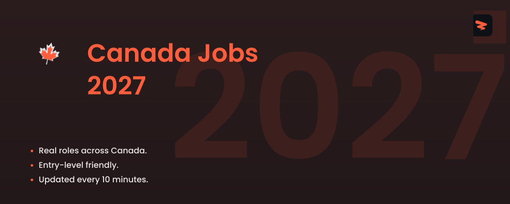

<!-- Cover -->

# Canada Jobs 2027

🚀 Entry-level, new-grad, and early-career jobs across Canada, sourced live and updated every 10 minutes.

  
  
  
  

---

## **Website & Autofill Extension**

Explore Zapply's website and check out:

- Our Chrome extension, which autofills job applications in seconds.
- A dedicated job board featuring the latest openings across various roles.
- User accounts with multiple profiles for different resume types and roles.
- Job application tracking with streaks and commitment awards.

Experience an advanced career journey with us! 🚀

  

## Explore Around

Connect and seek advice from a growing network of fellow students and new grads.

  
  &nbsp;&nbsp;
  

---

 

<h3>💻 <strong>Software Engineering</strong></h3>

| Company | Role | Location | Posted | Visa | **Apply** |
|---------|------|----------|--------|------|----------|
| **Beacon Software** | Portfolio Software Engineer | Toronto, ON | 15h |  |  |
| **S&P Global** | IT Service Operations, API and Cloud Warehouse Integrations | Calgary | 2d |  |  |
| **Citi** | AVP,  Software Engineer (Hybrid) | Mississauga Ontario Canada | 2d |  |  |
| **Google** | Software Engineer III, Infrastructure, Core | Canada | Date unknown |  |  |
| **NTT Data** | Java + SQL + Angular Developer | Toronto, ON | 2d |  |  |
| **Braze** | Software Engineer II, User Targeting | Toronto | 2d |  |  |
| **D2L** | Software Developer - Winter 2027 Co-op - Custom Development Services | Kitchener, ON | 2d |  |  |
| **Citi** | eTrading Java Developer, Front Office Trading | Mississauga Ontario Canada | 2d |  |  |
| **Lyft** | Software Engineer, GovTech | Toronto | 2d |  |  |
| **Microsoft** | Security Partner Solution Sales | Toronto, ON | 2d |  |  |
| **Cisco** | Software Developer (hybrid) | Vancouver | 3d |  |  |
| **Cisco** | Software Developer Full Stack / Backend I (Co-op) - Canada | Kanata Ontario Canada +7 more | 3d |  |  |
| **Cisco** | Software Developer Embedded Systems II (Co-op) – Canada | Kanata Ontario Canada +6 more | 3d |  |  |
| **Altera** | Software Engineer -  Intern | Toronto | 3d |  |  |
| **CIBC** | Consultant, Full Stack Developer | Toronto, ON | 3d |  |  |
| **CIBC** | Detection Engineer, Information Security | Toronto, ON | 3d |  |  |
| **TD Bank** | Software Engineer II | Toronto | 3d |  |  |
| **TD Bank** | Software Engineer II (Procurement and Risk Technology) | Toronto | 3d |  |  |
| **Allstate** | Digital Product Manager (Security Platforms) | Canadian Head | 3d |  |  |
| **Snap** | Software Engineer, Level 3, Backend | Toronto | 3d |  |  |
| **BMO** | Quantitative Developer, Global Asset Management | Toronto, ON | 3d |  |  |
| **Lumentum** | Technical Manager – Hardware Root of Trust & Platform Security | Canada - Ottawa | 3d |  |  |
| **JLL** | Coordonnateur, Sécurité/Security Coordinator | Montreal, QC | 3d |  |  |
| **TD Bank** | TD Asset Management Portfolio Analytics Developer Intern/Co-Op (Winter 2027) | 161 Bay Street Corporate | 3d |  |  |
| **Affirm** | Software Engineer II, Full Stack (Card Acquisition) | Canada | 3d |  |  |
| **Fortinet** | Presales Security Expert- Mid-Market | Calgary, AB | 3d |  |  |
| **Fortinet** | Software QA Specialist – FortiGate Cloud | Burnaby, BC | 3d |  |  |
| **Affirm** | Software Engineer I, Fullstack (Search) | Canada | 3d |  |  |
| **1Password** | Junior Developer | Remote | 3d |  |  |
| **1Password** | Junior Security Engineer | Remote | 3d |  |  |
| **Mastercard** | Software Engineer II | Toronto | 4d |  |  |
| **Johnson Controls** | Security Systems Technician | Saskatoon-Saskatchewan-Canada | 4d |  |  |
| **Johnson Controls** | Complex Security Systems Technician | Calgary-Alberta-Canada | 4d |  |  |
| **CIBC** | Consultant, Databricks Developer | Toronto, ON | 4d |  |  |
| **Motorola Solutions** | Software Developer in Test II (Backend) | Vancouver | 4d |  |  |
| **BMO** | Genesys Developer | Toronto, ON | 4d |  |  |
| **Citi** | Software Engineer | Mississauga Ontario Canada | 4d |  |  |
| **Mozilla** | Software Engineer, Firefox Desktop Integrations | Canada | 4d |  |  |
| **Nokia** | Embedded C/C++ SW Developer Co-op/Intern | Canada | 4d | ✅ Sponsor |  |
| **Fortinet** | Software Developer | Burnaby, BC | 4d |  |  |
| **Lyft** | ML Software Engineer, Routing | Toronto | 4d |  |  |
| **Microsoft** | Architecte de solutions cloud - Cloud et IA   Applications et innovation / Cloud Solution Architect | Quebec City, QC | 4d |  |  |
| **Microsoft** | Cloud Solution Architect (CSA) - Cloud & AI Data | Ottawa, ON | 4d |  |  |
| **Johnson Controls** | Security Systems Installation Technician | Ottawa-Ontario-Canada | 5d |  |  |
| **Pebl** | Software Engineering, Intern | Toronto, ON | 5d |  |  |
| **Capco** | DevOps Engineer | Canada - Toronto | 5d |  |  |
| **D-Wave Quantum** | Scientific Software Developer II \[634\] | Burnaby | Date unknown |  |  |
| **Capco** | AI Security Engineer | Canada - Toronto | 5d |  |  |
| **General Motors** | Embedded Simulation Developer - SIL and Virtualization | Markham | 6d |  |  |
| **BMO** | Devops Analyst - Technical | Toronto, ON | 6d |  |  |
| **BlackBerry** | QNX Everywhere Embedded Software Developer II | Ottawa | 6d |  |  |
| **Snowflake** | AI Software Engineer | Ontario-Toronto, CA | 6d |  |  |
| **onsemi** | Systems Developer | Waterloo, ON | 6d |  |  |
| **Google** | Software Developer III, Google Cloud Platforms, EasySaaS Deployments | Canada | Date unknown |  |  |
| **Google** | Partner Developer, YouTube | Canada | Date unknown |  |  |
| **General Motors** | DevOps Software Quality Automation Tools Engineer | Markham | 1w |  |  |
| **Aptiv** | Software Engineering Intern | CAN Kanata (2), ON | 1w |  |  |
| **Aptiv** | Cloud Engineering Intern | CAN Kanata (2), ON | 1w |  |  |
| **Aptiv** | Cloud Engineer Intern | CAN Kanata (2), ON | 1w |  |  |
| **Manulife** | Winter Co-op 2027 - Software Engineering | Toronto | 1w |  |  |
| **Capco** | Backend Developer – Java/Python & AI | Canada - Toronto | 1w |  |  |
| **Affirm** | Software Engineer II, Fullstack (Ads Platform) | Canada | 1w |  |  |
| **Sentry** | Software Engineer, Streaming Platform | Toronto, ON | 1w | ✅ Sponsor |  |
| **Asana** | Product Security Engineer | Vancouver, BC | 1w |  |  |
| **Capital One** | Associate, Software Engineer, New Grad Card Expansion | Toronto, ON | 1w |  |  |
| **Caterpillar** | Autonomy Systems Engineering Specialist / Spécialiste en ingénierie des systèmes d’autonomie | Laval | 1w |  |  |
| **Broadridge** | DevOps Engineer | Toronto, ON | 1w |  |  |
| **Manulife** | Back-End Software Engineer | Toronto | 1w |  |  |
| **Ecolab** | Junior Quality Control Software Developer | Calgary | 1w |  |  |
| **Carfax** | Associate Software Engineer | London | 1w |  |  |
| **Carfax** | Software Engineer | London | 1w |  |  |
| **Tower Research Capital** | Développeur de logiciels / Software Developer | Montreal | 1w | ✅ Sponsor |  |
| **Airbyte** | Customer Support Developer (Databases) | Remote | 1w |  |  |
| **Wealthsimple** | Marketing Automation Developer (18-month contract) | Remote | 1w |  |  |
| **Boeing** | Greenfield Full Stack Developer | CAN - Richmond | 1w |  |  |
| **Capital One** | Principal Associate, Software Engineering | Toronto, ON | 1w |  |  |
| **Cohere** | Office Manager & Security Coordinator | Ottawa | 1w |  |  |
| **MaintainX** | Développeur(se) Full Stack - Core | Montreal +1 more | 1w |  |  |
| **MaintainX** | Développeur(se) Full Stack – Plateforme et infrastructure | Montreal +1 more | 1w |  |  |
| **Tenstorrent** | Low-Level Software Engineer, LLK | Toronto, ON | 1w |  |  |
| **MaintainX** | Full-Stack Developer - Platform & Infrastructure | Toronto +1 more | 1w |  |  |
| **Motorola Solutions** | Software Developer, Embedded Appliances Co-Op | Vancouver | 1w |  |  |
| **Capital One** | Associate, Software Engineer, New Grad | Toronto, ON | 1w |  |  |
| **Stripe** | Backend Engineer, Payments & Risk | Toronto | 1w | ✅ Sponsor |  |
| **General Motors** | Early Career Software Test Developer - Propulsion Thermal Management | Markham | 1w |  |  |
| **Remitly** | Full Stack Software Engineer, Remitly Business | Burnaby | 1w |  |  |
| **Manulife** | Full-Stack Software Engineer | Waterloo Ontario +1 more | 1w |  |  |
| **Robinhood** | Software Engineer, Web3 Backend | Toronto | 1w |  |  |
| **HPE (University)** | Cloud Developer / Développeur Infonuagique | St. Laurent | 1w |  |  |
| **HPE** | Cloud Developer / Développeur Infonuagique | St. Laurent | 1w |  |  |
| **Qualcomm** | Firmware Engineer, Edge AI Silicon Validation (Embedded C) | Markham | 1w |  |  |
| **Stantec** | HVDC and Power Systems Engineer/Specialist | Kelowna, BC | 1w | ✅ Sponsor |  |
| **Snap** | Software Engineer, Android, Level 4 | Toronto | 1w |  |  |
| **Lumentum** | Embedded Software Engineer Co-op/Intern | Canada - Ottawa | 1w |  |  |
| **Nokia** | Jr. Embedded BSP SW Engineer | Canada | 1w | ✅ Sponsor |  |
| **Apple** | Full Stack Engineer - Apple TV and Sports | Vancouver | 1w |  |  |
| **Tower Research Capital** | Systems Developer, PAAS / Développeur de systèmes, PAAS | Montréal | 1w | ✅ Sponsor |  |
| **Asana** | Developer Advocate | Vancouver, BC | 1w |  |  |
| **Semtech** | Software Developer – Web/Cloud Application, Co-op | CAN - Richmond, BC | 2w |  |  |
| **Lumentum** | Embedded Software Developer Co-op (Optical Circuit Switch) | Canada - Ottawa | 2w |  |  |

Apply for more jobs at

<h3>⚙️ <strong>Hardware & Systems</strong></h3>

| Company | Role | Location | Posted | Visa | **Apply** |
|---------|------|----------|--------|------|----------|
| **Stantec** | Electrical Engineer | Calgary, AB | 3d | ✅ Sponsor |  |
| **Altera** | FPGA IP Design Engineer -  Intern | Toronto | 4d |  |  |
| **Stantec** | Electrical Engineering Intern – Buildings (Winter 2027) - 8 Month Term | Edmonton, AB | 4d | ✅ Sponsor |  |
| **Qualcomm** | ASIC/FPGA Design Verification Engineer | Ottawa | 4d |  |  |
| **Kent Building Supplies** | Quality Control Inspector, Electrical and Combat Systems | Halifax, NS | 4d |  |  |
| **General Motors** | Test Engineering, Data Engineering - Systems QA | Markham Ontario Canada +1 more | 5d |  |  |
| **Motorola Solutions** | Design Validation Co-op | Vancouver | 5d |  |  |
| **Generac** | Electrical Engineering Assistant - Battery Energy Storage | Cambridge | 5d |  |  |
| **Lumentum** | Electrical Engineer Co-op/Intern | Canada - Ottawa | 5d |  |  |
| **Kent Building Supplies** | Dept Mgr Electrical/Plumbing/Seasonal | Gander, NL | 6d |  |  |
| **Kent Building Supplies** | Electrical Maintainer | Saint John, NB | 1w |  |  |
| **Viavi Solutions** | Product Verification and Validation Engineer | Ottawa | 1w |  |  |
| **Stantec** | Substation Electrical Engineering Team Lead | Burnaby, BC | 1w | ✅ Sponsor |  |
| **WSP** | Electrical Engineer in Training (EIT) | Thornhill, ON | 1w | ✅ Sponsor |  |
| **Hitachi** | Stagiaire Génie Électrique et Contrôle / Electrical and Controls Engineering Intern | Varennes | 1w |  |  |
| **Qualcomm** | ASICS Design Verification Engineer (Vancouver, Markham OR Remote) | Canada | 1w |  |  |
| **Teledyne** | Stagiaire en conception de logiciels pour stations de validation 3D /Intern - 3D Validation... | Canada - Montreal, QC | 1w |  |  |
| **Johnson Controls** | Electrical Apprentice 4th | Nisku-Alberta-Canada | 1w |  |  |
| **Johnson Controls** | Electrical Apprentice 3rd Year | Nisku-Alberta-Canada | 1w |  |  |
| **Qualcomm** | ASICS Design Verification Engineer (Multiple Levels) - Vancouver OR Markham | Vancouver | 1w |  |  |
| **WSP** | Electrical Engineer - Transportation & Buildings | Thornhill, ON | 1w | ✅ Sponsor |  |
| **Hitachi** | Electrical Installations Design Engineer –Rail Systems | Toronto | 1w |  |  |
| **TD Bank** | Audit Manager I, Financial Crimes Issues Validation (944) | Toronto | 1w |  |  |
| **Hitachi** | Electrical Component Engineering Intern (Summer 2027, 16months) | Toronto | 2w |  |  |
| **Intel** | Graphics Hardware Validation Undergraduate Engineering Intern | Canada | 2w |  |  |
| **Marvell** | IC Validation Engineer Intern - BS/MS - 2027 Co-Op | Ottawa | 2w |  |  |
| **RTX** | Electrical Engineering Co-op | On, CA | 3w |  |  |
| **WSP** | Intern, Electrical Engineering | Toronto, ON | 3w | ✅ Sponsor |  |
| **ABB** | Mechanical Test Engineer Intern-Winter 2027 | Saint-Jean-sur-Richelieu | 3w |  |  |
| **Semtech** | Validation Engineering Intern | CAN - Burlington, ON | 3w |  |  |
| **Semtech** | Validation Engineering Intern | CAN - Ottawa, ON | 3w |  |  |
| **Marvell** | Data Center Silicon Hardware Engineering Intern - BS - 2027 Co-Op | Ottawa Canada +1 more | 3w |  |  |
| **Danaher** | Hardware Engineering Co-op | Concord | 3w |  |  |
| **Thermo Fisher Scientific** | Validation Engineering Co-op | Mississauga | 3w |  |  |
| **Danaher** | Hardware Engineering Co-op | Concord | 3w |  |  |
| **RTX** | Stage - Hiver 2027 - Soutien aux equipes HEP (hybrid-electric propulsion) et NSE (New Small... | Qc, CA | 1mo |  |  |
| **Rocket Lab** | Electrical Engineering Intern Summer 2027 | Toronto | 1mo |  |  |
| **Rocket Lab** | Electrical Engineering Intern Spring 2027 | Toronto | 1mo |  |  |
| **RTX** | Stage - Hiver 2027-  Soutien aux équipes HEP (hydro-électrique propulsion) Soutien au design,... | Qc, CA | 1mo |  |  |
| **Cisco** | Analog/Mixed-signal ASIC Sustain & Designer - Acacia (Hybrid) | Kanata | 1mo |  |  |
| **Motorola Solutions** | Firmware Validation, Co-Op | Vancouver | 1mo |  |  |
| **ABB** | Electrical Engineering Intern-Fall 2026 | Milton | 2mo |  |  |
| **IEM** | Electrical Production Assembler | Surrey, BC | 4mo |  |  |

Apply for more jobs at

<h3>🔬 <strong>Data Science & Analytics</strong></h3>

| Company | Role | Location | Posted | Visa | **Apply** |
|---------|------|----------|--------|------|----------|
| **Apple** | Machine Learning Engineer, Software QA - Creativity Apps | Vancouver | 2d |  |  |
| **TD Bank** | Research Machine Learning Scientist II | Toronto | 2d |  |  |
| **Affirm** | Machine Learning Engineer II (ROA + LTV ML) | Canada | 2d |  |  |
| **Motorola Solutions** | Marketing Data & AI Analytics Specialist | Toronto | 3d |  |  |
| **BMO** | Manager Stress Testing Analytics | Toronto, ON | 3d |  |  |
| **BMO** | Associate, Data Scientist | Toronto, ON | 3d |  |  |
| **BMO** | Analyst, Data Scientist | Toronto, ON | 3d |  |  |
| **TD Bank** | TD Asset Management Portfolio Analytics Data Analyst Intern/Co-Op (Winter 2027) | Toronto | 3d |  |  |
| **TD Bank** | Actuarial Analyst I | Montréal | 3d |  |  |
| **Tower Research Capital** | Machine Learning Intern | Montreal | 3d | ✅ Sponsor |  |
| **Asana** | Data Scientist | Vancouver, BC | 3d |  |  |
| **Boeing** | Analytics Business Operations Intern (Commercial Services) | CAN Richmond Canada +1 more | 4d |  |  |
| **Boeing** | Analytics Business Operations Intern (Government Services) | CAN Richmond Canada +1 more | 4d |  |  |
| **1Password** | Data Analyst, Finance Analytics | Remote | 4d |  |  |
| **Microsoft** | Stagiaire en recherche - apprentissage automatique; Research Intern - Machine Learning | Montreal, QC | 4d |  |  |
| **CIBC** | Consultant, Risk Analytics | Toronto, ON | 5d |  |  |
| **CIBC** | Consultant, Compliance Reporting & Analytics | Toronto, ON | 5d |  |  |
| **Capital One** | Intern, Data Scientist - Winter 2027 | Toronto, ON | 5d |  |  |
| **Capital One** | Intern, Data Scientist - Summer 2027 | Toronto, ON | 5d |  |  |
| **Morgan Stanley** | Data Scientist (NLP Specialist) – Legal and Compliance (Hybrid) | Montreal | 6d |  |  |
| **Morgan Stanley** | Procurement & Supplier Analytics Associate (Hybrid) | Montreal | 6d |  |  |
| **Johnson Controls** | Program Manager - Workforce Analytics | Nisku-Alberta-Canada | 6d |  |  |
| **Nissan** | Sales & Marketing, Data Scientist | Mississauga | 6d |  |  |
| **Amazon Development Centre Canada ULC** | Data Scientist, ADE Analytics | Vancouver, BC | 6d | ✅ Sponsor |  |
| **Carfax** | Data Scientist | London | 6d |  |  |
| **1Password** | Data Intern  - Product Analytics - Winter 2027 | Remote | 6d |  |  |
| **Amazon Development Centre Canada ULC** | Business Intelligence Engineer, IT PnD Data & Analytics (DnA) | Vancouver, BC | 1w | ✅ Sponsor |  |
| **SS&C Technologies** | Analyst, Risk Analytics & Performance | Toronto Canada +1 more | 1w |  |  |
| **PointClickCare** | Marketing Data Analytics Engineer (CA) | Remote | 1w |  |  |
| **CIBC** | Associate, Business Analytics | Toronto, ON | 1w |  |  |
| **Canadian Tire** | Data Engineer, Enterprise Data, Insights & Analytics | Toronto, ON | 1w | ✅ Sponsor |  |
| **Canadian Tire** | Business Data Analyst | Oakville, ON | 1w | ✅ Sponsor |  |
| **Kent Building Supplies** | Data Scientist Student – Winter 2027 | Saint John, NB | 2w |  |  |
| **Pinterest** | Machine Learning Intern 2027 (Toronto) | Toronto, ON | 2w |  |  |
| **Stripe** | Data Analyst, Intern | Toronto | 2w | ✅ Sponsor |  |
| **Stripe** | PhD Data Scientist, Intern | Toronto | 2w | ✅ Sponsor |  |
| **Manulife** | Winter Co-op 2027 - ALM Data Management & Analytics | Toronto | 2w |  |  |
| **Nokia** | Operations Analytics Co-op/Intern | Canada | 3w | ✅ Sponsor |  |
| **RTX** | Stage - Hiver 2027 - Analyste de données, Services de pièces de rechange / Internship - Winter... | Qc, CA | 1mo |  |  |
| **Qualcomm** | FY27 Intern - Machine Learning Compiler & Performance Engineering Intern - Canada (16 months) | Markham | 1mo |  |  |
| **RTX** | Stage - Hiver 2027 -  Analyste d’affaires et de Données / Internship - Winter 2027 -  Business &... | Qc, CA | 1mo |  |  |
| **Capital One** | Intern, Data Analytics Engineering - Winter 2027 | Toronto, ON | 1mo |  |  |
| **Teledyne** | LiDAR Data Analyst (Co-op) | Canada - Concord, ON | 1mo |  |  |
| **Manulife** | Winter Co-op 2027 - Data & Analytics (8 Months) | Toronto | 1mo |  |  |
| **Manulife** | Winter Co-op 2027 - Data & Analytics | Toronto | 1mo |  |  |
| **Kent Building Supplies** | Data Analyst Student, Corporate HR - Winter 2027 | Saint John, NB | 1mo |  |  |
| **RTX** | Stage - Hiver 2027 -  Analyse avancée projet d'évolution de l'IA  / Internship - Winter 2027 -... | Qc, CA | 1mo |  |  |
| **Kent Building Supplies** | Finance Data Analyst Student - Winter 2027 | Saint John, NB | 1mo |  |  |
| **Affirm** | Quantitative Analyst II (Capital Structuring & Analytics) | Canada | 1mo |  |  |
| **Epic Games** | Machine Learning Intern | Montreal, QC | 2mo |  |  |
| **Stripe** | Data Scientist, Fraud | Toronto | 2mo | ✅ Sponsor |  |
| **Affirm** | Machine Learning Engineer II (Underwriting ML) | Canada | 2mo |  |  |
| **Lyft** | Machine Learning Engineer, Safety and Customer Care AI | Toronto | 2mo |  |  |
| **Lyft** | Machine Learning Engineer, Lyft Business & Ads | Toronto | 3mo |  |  |
| **Scale AI** | Machine Learning Fellow - Human Frontier Collective (Canada) | Canada | 8mo |  |  |
| **StackAdapt** | Machine Learning Engineer | Alberta +9 more | 13mo |  |  |
| **Reddit** | Machine Learning Engineer | Ontario | 14mo |  |  |
| **Cresta** | Machine Learning Engineering Intern | Toronto | 25mo |  |  |

Apply for more jobs at

<h3>🤖 <strong>AI / ML</strong></h3>

| Company | Role | Location | Posted | Visa | **Apply** |
|---------|------|----------|--------|------|----------|
| **CIBC** | Mobile Mortgage Advisor (Commission only), Gimli, MB | Gimli, MB | 35m |  |  |
| **Kent Building Supplies** | Production Engineer - Paint Specialist | Halifax, NS | 12h |  |  |
| **TD Bank** | Personal Banking Associate - Pointe-Claire, Colonnades (Full time) | Pointe Claire | 1d |  |  |
| **CIBC** | Customer Service Representaitive | Listowel, ON | 2d |  |  |
| **Abbott** | Regulatory Affairs Specialist – Abbott Medical Devices (Mississauga) | Mississauga, ON | 2d |  |  |
| **Microsoft** | Applied Scientist - CoreAI Voice Agent | Vancouver, BC | 2d |  |  |
| **TD Bank** | Manager, Customer Experience Trainee - Montreal-Ouest | Dollard-des-Ormeaux | 3d |  |  |
| **Boeing** | Aircraft Structures Technician (C-17) | CAN CFB Trenton Canada +8 more | 3d |  |  |
| **Intel** | GPU & AI Accelerator Hardware Design Undergraduate Intern | Canada | 3d |  |  |
| **General Motors** | Paint Mechanical Engineering Specialist | Oshawa | 3d |  |  |
| **Johnson Controls** | BEST Technical Sales Trainee - Equipment - Toronto, CA | Richmond Hill-Ontario-Canada | 3d |  |  |
| **CIBC** | Financial Services Representative - La Prairie | La Prairie, QC | 3d |  |  |
| **TD Bank** | AI / ML Product Engineer | Toronto | 3d |  |  |
| **Warner Bros. Discovery** | Gestionnaire, Recherche expérience joueur.euse / Manager, Player Experience Research | Montreal 888 | 3d |  |  |
| **Warner Bros. Discovery** | Gestionnaire technique du co-développement / Technical Co-Development Manager | Montreal 888 | 3d |  |  |
| **AstraZeneca** | AI Business Support Specialist Intern | Canada - Mississauga | 3d |  |  |
| **Nike** | Retail Associate, SEAS - Nike Dixie | Mississauga | 3d |  |  |
| **Trane Technologies** | 2027 Stagiaire en vente technique - Équipement / Technical Sales Intern - Equipment | Laval | 3d |  |  |
| **JLL** | Technicien(ne) de maintenance bâtiment | Bromont, QC | 3d |  |  |
| **WSP** | Stagiaire, Génie mécanique | Rouyn-Noranda, QC | 3d | ✅ Sponsor |  |
| **Kent Building Supplies** | Maintenance Systems Coordinator | Dieppe, NB | 3d |  |  |
| **Sherwin-Williams** | Management and Sales Trainee | Courtenay, BC | 3d |  |  |
| **Sherwin-Williams** | Assistant Sales Trainee Manager | Courtenay, BC | 3d |  |  |
| **UPS** | Early Morning Preload - Kamloops | KAMLOOPS | 3d |  |  |
| **UPS** | Air Walker | DIEPPE | 3d |  |  |
| **UPS** | Air Walker | MOUNT PEARL | 3d |  |  |
| **Airbnb** | Enquêteur ou enquêteuse en situation de crise communautaire | Canada | 3d |  |  |
| **Parsons** | AI & Digital Innovation Engineering Intern | ON, CA | Date unknown |  |  |
| **State Street** | Application Support Engineer – SWIFT & Mainframe, Assistant Vice President | Toronto | 4d |  |  |
| **Stanley Black & Decker** | Expéditeur/réceptionnaire/Shipper/Receiver | Montreal | 4d |  |  |
| **National Interstate Insurance** | Claims Representative - Executive Liability Division | British Columbia | 4d |  |  |
| **Johnson & Johnson** | Regulatory Affairs Specialist | Markham | 4d |  |  |
| **RTX** | Stage - Hiver 2027 - Stagiaire en Ressources Humaines / Internship - Winter 2027 -  Human... | Qc, CA | 4d |  |  |
| **RTX** | Electro/Mechanical Maintenance technician | Ns, CA | 4d |  |  |
| **RTX** | ILS Specialist (Reliability & Maintainability Engineer) | Ab, CA | 4d |  |  |
| **Starbucks** | barista - Store# 50324, Macleod Trail & 72nd | 7218 Macleod Trail SE | 4d |  |  |
| **Capital One** | Manager, AI Engineer | Toronto, ON | 4d |  |  |
| **Stantec** | AI & Automation Solutions Specialist | Toronto, ON | 4d | ✅ Sponsor |  |
| **Stantec** | Engineer-in-Training, Community Development | Edmonton, AB | 4d | ✅ Sponsor |  |
| **Sherwin-Williams** | Management and Sales Trainee | Waterloo, ON | 4d |  |  |
| **Cummins** | Gestionnaire de territoire-Marché routier | Pointe-Claire, QC | 4d |  |  |
| **Airbnb** | Gestionnaire, Excellence de la prestation de services | Ontario | 4d |  |  |
| **NBCUniversal** | ML Solutions Architect - Architecte de solutions ML | Montréal, QC | 4d |  |  |
| **AbbVie** | Pipeline Medical Science Liaison, Oncology | Toronto, ON | 4d |  |  |
| **Red Bull** | Supply Chain Specialist | Chilliwack, BC | 4d |  |  |
| **Mastercard** | Manager- Responsible AI | Toronto | 5d |  |  |
| **Elanco** | Technical Services Veterinarian / Vétérinaire des Services Techniques (Veterinary Product... | Canada | 5d |  |  |
| **KION Group** | Resident Maintenance Technician | Montreal, QC | 5d |  |  |
| **Carrier Global** | Gestionnaire de service | LOC13059 625 | 5d |  |  |
| **Johnson Controls** | Facility Maintenance Technician | Kingston-Ontario-Canada | 5d |  |  |
| **Air Liquide** | Coordinator Fleet Maintenance | Edmonton, AB | 5d |  |  |
| **Allstate** | Allstate Sales Agent Trainee | Canadian Head | 5d |  |  |
| **Hitachi** | Stagiaire en Génie Manufacturier/Manufacturing Engineering Intern | Varennes | 5d |  |  |
| **Hitachi** | Technicien maintenance électrique – Quart de nuit | Quebec | 5d |  |  |
| **Hitachi** | Stagiaire en maintenance/ Maintenance Intern | Varennes | 5d |  |  |
| **BMO** | Mortgage Specilaist | Edmonton, AB | 5d |  |  |
| **Teledyne** | Gestionnaire de projets d’automatisation | Canada - Bromont, QC | 5d |  |  |
| **Canadian Tire** | Financial Analyst, Supply Chain and Logistics FP&A | Toronto, ON | 5d | ✅ Sponsor |  |
| **Capital One** | Principal Associate, AI Engineer | Toronto, ON | 5d |  |  |
| **Amazon Development Centre Canada ULC** | Software Development Engineer II, Campaign Management | Toronto, ON | 5d | ✅ Sponsor |  |
| **Kent Building Supplies** | Warehouse Associate (Blending Production) - Saint John | Saint John, NB | 5d |  |  |
| **MaintainX** | Gestionnaire de la réussite client – Intelligence des actifs | Montreal | 5d |  |  |
| **AbbVie** | Medical Science Liaison - Allergan Aesthetics | Montreal, QC | 5d |  |  |
| **Boeing** | Aircraft Mechanic AME M2 (C-17) | CAN CFB Trenton Canada +7 more | 6d |  |  |
| **BMO** | Mainframe Capacity and Performance Specialist | Toronto, ON | 6d |  |  |
| **Thermo Fisher Scientific** | Medical Science Liaison, Field-based, Canada (French-Speaking) | Montreal Canada +2 more | 6d |  |  |
| **ABB** | Engineering Discovery Trainee | Milton | 6d |  |  |
| **Starbucks** | barista - Store# 04987, METRAL STATION - NANAIMO | 6334 Metral Drive | 6d |  |  |
| **Starbucks** | barista - Store# 63881, LA PRAIRIE - BLVD TASCHEREAU | 155 Boul Taschereau | 6d |  |  |
| **Stantec** | Technicienne / Technicien conception, Infrastructures urbaines | Quebec, QC | 6d | ✅ Sponsor |  |
| **NTT Data** | AI Solution Architect / FDE (AWS and Azure) - | Toronto, ON | 6d |  |  |
| **NVIDIA** | PhD Research Intern, Quantum and AI for Chemistry - 2027 | Canada | 1w |  |  |
| **Enghouse** | Campaign Manager (12 Month Contract) | Winnipeg | Date unknown |  |  |
| **AbbVie** | Gestionnaire d’équipe terrain, Est - AbbVie Care | Montreal, QC | 1w |  |  |
| **Avis Budget Group** | Agent de Service   Car Detailer | 850 Jean Paul Laframboise, QC | 1w |  |  |
| **BMO** | Spécialiste Hypothécaire | Sherbrooke, QC | 1w |  |  |
| **Canadian Tire** | Supply Chain & Fulfillment Analyst | Calgary, AB | 1w | ✅ Sponsor |  |
| **Canadian Tire** | CRM and Email Operations Specialist | Laval, QC | 1w | ✅ Sponsor |  |
| **MaintainX** | Gestionnaire de comptes – marché intermédiaire | Montreal | 1w |  |  |
| **Great Question** | Product Engineer (AI / Full-Stack) | Remote | 1w |  |  |
| **WPP Media** | Manager, Media Innovation & AI Strategy | Toronto | 1w |  |  |
| **Moderna** | Co-Op, Supply Chain Planning | Laval - Canada | 1w |  |  |
| **Amazon Development Centre Canada ULC** | Software Development Engineer II, Umbrella Training | Toronto, ON | 1w | ✅ Sponsor |  |
| **Honeywell** | Maintenance Mechanic - Painter | Woodstock, ON | 1w |  |  |
| **WSP** | Intern, Transit and Rail Engineering | Toronto, ON | 1w | ✅ Sponsor |  |
| **WSP** | Stagiaire, Génie civil | Mont-Laurier, QC | 1w | ✅ Sponsor |  |
| **MaintainX** | Gestionnaire, développement des affaires | Montreal | 1w |  |  |
| **DRW** | Platform Engineer - AI Engineering | Montreal | 1w |  |  |
| **Autodesk** | PhD Researcher, AI Research | Toronto, ON | 1w | ✅ Sponsor |  |
| **HPE** | Named Accounts Manager - Networking / Gestionnaire de comptes nommés - Réseau | Montreal | 1w |  |  |
| **HPE (University)** | Named Accounts Manager - Networking / Gestionnaire de comptes nommés - Réseau | Montreal | 1w |  |  |
| **Manulife** | AVP, AI | Toronto | 1w |  |  |
| **Lyft** | Partenaire d’affaires RH, Lyft Solutions Urbaines | Montreal | 1w |  |  |
| **Apple** | Area Manager, Channel Retail | Edmonton Metro Area | 1w |  |  |
| **Google** | Manager, Agent Development, Applied AI | Canada | Date unknown |  |  |
| **Parsons** | Ingénieur(e) en maintien de la circulation | QC, CA | Date unknown |  |  |
| **General Mills** | Maintenance Millwright/Mechanic | Winnipeg, MB | 1w |  |  |
| **TJX** | Retail Store Associate Part Time Seasonal Winners-Sunridge Mall | Calgary | 1w |  |  |
| **TJX** | Temporary Retail Customer Service Coordinator Full Time Winners - Dorval Crossing Oakville | Oakville | 1w |  |  |
| **TJX** | Associé / Associée de Magasin de Détail Temps Partiel Winners- Smart Centres Laval Est | Laval | 1w |  |  |

Apply for more jobs at

<h3>🛠️ <strong>Operations & Support</strong></h3>

| Company | Role | Location | Posted | Visa | **Apply** |
|---------|------|----------|--------|------|----------|
| **BMO** | Wealth Planning Advisor- Quality & Support | Toronto, ON | 14m |  |  |
| **JLL** | Support Aux Opérations / Adjoint(e) administratiif(ve) | Bromont, QC | 2d |  |  |
| **Tailscale** | Program Manager, EPD Operations | Canada | 2d |  |  |
| **Wealthsimple** | Associate, Fund Operations | Remote | 2d |  |  |
| **BMO** | Support Analyst - Unified Communications | Toronto, ON | 3d |  |  |
| **Morgan Stanley** | Platform Reliability & Prod Support Specialist (Hybrid) | Montreal | 3d |  |  |
| **Remitly** | Compliance Operations Analyst | Burnaby | 3d |  |  |
| **TD Bank** | Operations Officer III | Mississauga | 3d |  |  |
| **Thermo Fisher Scientific** | Operations Strategy Co-Op | Mississauga | 3d |  |  |
| **Thermo Fisher Scientific** | Scientist I – Analytical Operations | Mississauga | 3d |  |  |
| **Thermo Fisher Scientific** | Field Service Engineer II (Bulk Elemental Analysis) Toronto REMOTE | Toronto | 3d |  |  |
| **BMO** | Centralized Support Associate, Nesbitt Burns | QC | 3d |  |  |
| **Citi** | Apps Support Analyst - Officer | Mississauga Ontario Canada | 3d |  |  |
| **WSP** | Technician - Wind and Solar Field Services | Calgary, AB | 3d | ✅ Sponsor |  |
| **Kent Building Supplies** | Operations Call Crew | Saint John, NB | 3d |  |  |
| **Cummins** | Engine Field Service Technician | ON | 3d |  |  |
| **Cummins** | Power Generation Field Service Technician | Dartmouth, NS | 3d |  |  |
| **Airbyte** | Technical Support Engineer | Remote | 3d |  |  |
| **TransUnion** | Specialist - Revenue Operations and Analysis | Burlington | 4d |  |  |
| **Manulife** | Business Consultant, Group Benefit Operations | Waterloo Ontario +1 more | 4d |  |  |
| **Salesforce** | Customer Success Manager | Canada - Toronto | 4d |  |  |
| **Nokia** | DCE 4LS Customer Support Engineer | Canada | 4d | ✅ Sponsor |  |
| **IEM** | Operations Administrator | Surrey, BC | 4d |  |  |
| **TD Bank** | Group Manager I, TDS Operations | Toronto | 4d |  |  |
| **UiPath** | Technical Program Manager II | Toronto | 4d |  |  |
| **Harvey** | Enterprise Customer Success Manager | Toronto | 4d |  |  |
| **Microsoft** | Customer Success Account Management | Greater Toronto, ON | 4d |  |  |
| **Docker** | Legal Operations Analyst | Remote | 4d |  |  |
| **Teledyne** | Survey Operations Specialist | Canada - Concord, ON | 5d |  |  |
| **Salesforce** | Customer Success Manager - Global Public Sector | Canada Toronto +2 more | 5d |  |  |
| **Wealthsimple** | Intern, Client Experience Strategy & Operations | Remote | 5d |  |  |
| **Affirm** | Product Support Specialist I (Merchant Care) | Canada | 6d |  |  |
| **TD Bank** | Wealth Operations Officer III | Toronto | 6d |  |  |
| **Northeastern University** | Customer Service & Campus Operations Assistant | Vancouver, BC | 6d |  |  |
| **RTX** | Stage - Hiver 2027 - Stage en conception mécanique – Support aux opérations / Internship -... | Qc, CA | 6d |  |  |
| **BlackBerry** | QNX Ecosystem Program Manager | Ottawa | 6d |  |  |
| **ABB** | Field Service Technician | Sudbury Ontario Canada +3 more | 6d |  |  |
| **Kent Building Supplies** | Forestry Operations Intern - Summer 2027 | Saint-Leonard, NB | 6d |  |  |
| **WSP** | Experienced Technician - Wind and solar field services | Calgary, AB | 6d | ✅ Sponsor |  |
| **1Password** | Finance Intern - Finance Operations - Winter 2027 | Remote | 6d |  |  |
| **Disney** | Product Manager, Conversational Support | BC | 1w |  |  |
| **Ecolab** | Field Service Engineer | Calgary | 1w |  |  |
| **GitLab** | Senior Solutions Architect Operations Manager | United States +1 more | 1w |  |  |
| **RTX** | Technologies numériques - Opérations manufacturières : Analyste des systèmes MES / Digital... | Qc, CA | 1w |  |  |
| **Manulife** | Associate Manager, Audit Operations & Reporting | Toronto | 1w |  |  |
| **Canadian Tire** | Operations Planning Analyst | Calgary, AB | 1w | ✅ Sponsor |  |
| **Amazon.com.ca, ULC - A49** | Operations Finance (OFRP) Intern - Summer 2027, Amazon Finance Rotational Program (AFRP) | Toronto, ON | 1w |  |  |
| **WSP** | Design Support Technician | Sudbury, ON | 1w | ✅ Sponsor |  |
| **Microsoft** | Customer Success Account Manager | Toronto, ON | 1w |  |  |
| **Hitachi** | Coordonnateur(trice) de projets – Fabrication et opération / Project Coordinator – Manufacturing... | Saint-Laurent | 1w |  |  |
| **Cigna** | Pharmacy Operations & Product Advisor - 14 Months Mat Leave Contract-Express Scripts Canada | Mississauga, ON | 1w |  |  |
| **ABB** | Sales Support Specialist ( 6 month contract ) | Milton | 1w |  |  |
| **ABB** | Warehouse support specialist | Bromont | 1w |  |  |
| **Kent Building Supplies** | Integrated Logistics Support Analyst | Halifax, NS | 1w |  |  |
| **Manulife** | Summer Intern 2027 - Business Operations & Executive Reporting Co-op | Toronto | 1w |  |  |
| **Qualcomm** | Customer Program Manager | Ottawa | 1w |  |  |
| **Cummins** | Engine Field Service Technician | Thunder Bay, ON | 1w |  |  |
| **Motorola Solutions** | Technical Support Engineer | Vancouver | 1w |  |  |
| **RTX** | Stage - Hiver 2027 - Support technique / Internship - Winter 2027 - Technical support | Qc, CA | 3w |  |  |
| **Marvell** | Internship Program Operations and Events Co-Op - Winter 2027 | ON - Ontario - Toronto, CA | 3w |  |  |
| **StackAdapt** | Ad Operations Specialist | Canada | 1mo |  |  |
| **Nozomi Networks** | Technical Support Engineer | Canada | 1mo |  |  |
| **Nokia** | Customer Technical Support Co-op/Intern | Canada | 1mo | ✅ Sponsor |  |
| **AstraZeneca** | Biopharma Study Management Operations GSA Intern | Canada - Mississauga | 1mo |  |  |
| **Nokia** | Optical Network Mgmt Support Intern | Canada | 1mo | ✅ Sponsor |  |
| **Scopely** | Licensing Operations Coordinator | Canada, CA | 1mo |  |  |
| **Johnson & Johnson** | Marketing Operations Co-Op | Markham | 1mo |  |  |
| **Alo Yoga** | Seasonal Operations Associate (Part-Time) - Sherway Gardens | Etobicoke, ON | 1mo |  |  |
| **Alo Yoga** | Seasonal Operations Associate (Part-Time) - Toronto Eaton Centre | Toronto Eaton Centre, ON | 1mo |  |  |
| **Alo Yoga** | Seasonal Operations Associate (Part-Time) - Oakridge Centre | Oakridge Centre, BC | 1mo |  |  |
| **CaptiveAire Systems** | Technical Sales and Field Service Engineer | Ottawa, ON | 2mo |  |  |
| **Samsara** | Manager I, Customer Success Manager | Canada | 2mo |  |  |
| **Affirm** | Operations Enablement Manager | Canada | 2mo |  |  |
| **GitLab** | Support Engineer (AMER) | United States +1 more | 2mo |  |  |
| **Airbnb** | Support Specialist, Safety | Canada | 10mo |  |  |

Apply for more jobs at

<h3>📂 <strong>Other Tech Roles</strong></h3>

| Company | Role | Location | Posted | Visa | **Apply** |
|---------|------|----------|--------|------|----------|
| **RTX** | Assembly Technician – Afternoon Shift | On, CA | 5m |  |  |
| **RTX** | Environmental, Health & Safety Manager - Contract | On, CA | 5m |  |  |
| **Apple** | CA - Specialist: Seasonal, Part-time | Canada | 11m |  |  |
| **BMO** | Mortgage Specialist | Newmarket, ON | 14m |  |  |
| **BMO** | Mortgage Specialist | Barrie, ON | 14m |  |  |
| **CIBC** | Client Associate, Wood Gundy | Halifax, NS | 35m |  |  |
| **CIBC** | Mobile Mortgage Advisor - (Commission Only) - Calgary, Alberta | Calgary, AB | 35m |  |  |
| **CIBC** | Mobile Mortgage Advisor - (Commission Only) - Fort McMurray, Alberta | Fort McMurray, AB | 35m |  |  |
| **TD Bank** | Data Engineer II | Toronto | 44m |  |  |
| **TD Bank** | IT Manager Development (Java/Spring Boot and Enterprise Applications) | Toronto | 44m |  |  |
| **TD Bank** | Bus Sys Analysis Specialist | Toronto | 44m |  |  |
| **JLL** | Mech and Robotics Tech | Delta, BC | 7h |  |  |
| **Kent Building Supplies** | Production Engineer - Temporary Services | Halifax, NS | 12h |  |  |
| **Amazon Studios Canada, Inc.** | Marketing Coordinator, Amazon MGM Studios Theatrical Marketing | Toronto, ON | 12h |  |  |
| **Kent Building Supplies** | National Fleet Coordinator | Dieppe, NB | 12h |  |  |
| **Kent Building Supplies** | Gatehouse Associate | Amherst, NS | 12h |  |  |
| **State Street** | Technical Business Analyst,AVP | Toronto | 1d |  |  |
| **RELX** | Content Lawyer (Commercial) | Canada Toronto Sheppard Ave +11... | 1d |  |  |
| **UPS** | 9046N AM Gateway Sort | RICHMOND | 1d |  |  |
| **UPS** | Package Handler | CALEDON | 1d |  |  |
| **UPS** | Warehouse Associate/SorterPM | CONCORD | 1d |  |  |
| **Ecolab** | Assembly Technician | Calgary | 1d |  |  |
| **JLL** | Technicien HVAC | Sherbrooke, QC | 2d |  |  |
| **JLL** | Électromécanicien/Mécanicien de bâtiment / Electromechanic/Building Mechanic | Saint-Constant, QC | 2d |  |  |
| **Starbucks** | barista - Store# 04741, TERMINAL PARK MALL | 1150 North Terminal Avenue | 2d |  |  |
| **Starbucks** | barista - Store# 04700, WONDERLAND & SOUTHDALE | 3059 Wonderland Rd S | 2d |  |  |
| **Starbucks** | barista - Store# 23046, 12 HEBRON WAY | 12 Hebron Way | 2d |  |  |
| **Abbott** | Remote Care Technician – Cardiac Rhythm Management - Mississauga | Mississauga, ON | 2d |  |  |
| **Abbott** | Diabetes Sales Specialist - Kitchener/Waterloo - Abbott Diabetes Care | ON | 2d |  |  |
| **Waymo** | Legal Counsel - Canada | Toronto, ON | 2d |  |  |
| **BMO** | BMO Capital Markets Summer 2027 Investment Banking Analyst, Toronto | Toronto, ON | 2d |  |  |
| **Samsara** | People Partner | Canada | 2d |  |  |
| **2K Games** | Technical Test Analyst II / I | Vancouver, BC | 2d |  |  |
| **Lightspeed** | Team Lead, Hospitality Sales | Montreal | 2d |  |  |
| **Lightspeed** | Team Lead, Hospitality Sales | Montreal | 2d |  |  |
| **RTX** | Ingénieur(e) en conception de logiciels de systèmes de commande / Control Systems Software... | Qc, CA | 2d |  |  |
| **Eurofins** | Business/Sales Analyst - Eurofins Cosmetics & Personal Care, Inc. | Toronto, ON | 2d |  |  |
| **AbbVie** | Chef, Exécution de projets stratégiques, Gastroentérologie | Montreal, QC | 2d |  |  |
| **AbbVie** | Manager, Strategic Project Execution, Gastroenterology | Montreal, QC | 2d |  |  |
| **Scale AI** | Safety Research Scholar - Human Frontier Labs | United States +2 more | 2d |  |  |
| **Geotab** | Business Development Associate - Public Sector | Canada | 2d |  |  |
| **D2L** | Solutions Engineer | Canada | 2d |  |  |
| **Microsoft** | Producer -  Gears of War - The Coalition (12-Month Fixed-Term Contract) | Vancouver, BC | 2d |  |  |
| **Lucid Motors** | Spécialiste des ventes (Sales Specialist) | Montreal, QC | 2d |  |  |
| **Intel** | Thermal Mechanical Engineering Undergraduate Intern, GPU Platforms | Canada | 3d |  |  |
| **Fiserv** | Quality Assurance Engineering - Advisor I | Mississauga - Skymark | 3d |  |  |
| **Fiserv** | Account Manager, French Bilingual | Mississauga - Skymark | 3d |  |  |
| **Fiserv** | Account Executive   Chargé(e) de Comptes | Quebec | 3d |  |  |
| **Sysco** | MDM Analyst, Item Enrichment | Sysco Canada Inc. | 3d |  |  |
| **Sysco** | Account Manager | Sysco Canada Inc. | 3d |  |  |
| **Sysco** | Bilingual National Sales Coordinator | Sysco Canada Inc. | 3d |  |  |
| **Mastercard** | Manager, Product Management | Toronto | 3d |  |  |
| **Stanley Black & Decker** | Product Syndication Specialist | Mississauga | 3d |  |  |
| **Stanley Black & Decker** | Bilingual Consumer Credit Representative | Waterloo | 3d |  |  |
| **Curtiss-Wright** | Mechanical Design (Structural Design & Analysis) Engineer | Canada-Newmarket | 3d |  |  |
| **Cigna** | Registered Pharmacy Technician - Express Scripts Canada | Mississauga, ON | 3d |  |  |
| **Air Liquide** | Accounts Receivables Agent (Temporary) | Edmonton, AB | 3d |  |  |
| **Baker Hughes** | ALS Leduc Master Scheduler | Ab, CA | 3d |  |  |
| **Baker Hughes** | Field Specialist III | Ab, CA | 3d |  |  |
| **Johnson Controls** | Assembler I | Nisku-Alberta-Canada | 3d |  |  |
| **Johnson Controls** | HVAC Dispatch & Resource Coordinator | Dartmouth-Nova Scotia-Canada | 3d |  |  |
| **Johnson Controls** | Fire Alarm Inspector | Brampton-Ontario-Canada | 3d |  |  |
| **Allegion** | Technicien de Service - Stanley Access Technologies, Montreal, Quebec | Remote | 3d |  |  |
| **Air Liquide** | Sales coordinator | Montreal, QC | 3d |  |  |
| **Coca-Cola** | QA Tech - $32.60/HR (Continental Schedule) | Canada - ON - Peterborough | 3d |  |  |
| **Warner Bros. Discovery** | Programmeur.euse avancé.e, jouabilité / Advanced Gameplay Programmer | Montreal 888 | 3d |  |  |
| **Warner Bros. Discovery** | Animateur.trice avancé.e / Advanced Animator | Montreal 888 | 3d |  |  |
| **Warner Bros. Discovery** | Concepteur.trice technique avancé.e / Advanced Technical Designer | Montreal 888 | 3d |  |  |
| **Teledyne** | Credit and Collections Analyst | Canada - Waterloo, ON | 3d |  |  |
| **Johnson & Johnson** | Territory Account Manager (Southwestern Ontario) – Johnson & Johnson MedTech Vision Care | Toronto Ontario Canada +2 more | 3d |  |  |
| **Johnson & Johnson** | Medical Writer III, Oncology | Toronto | 3d |  |  |
| **Workday Inc** | Software Development Engineer - Agent Factory | BC | 3d |  |  |
| **Hitachi** | CI Maturity Development Intern | Stoney Creek | 3d |  |  |
| **Thermo Fisher Scientific** | Lab Execution Systems Co-Op | Mississauga | 3d |  |  |
| **Thermo Fisher Scientific** | Business Manager - Onsite Whitby Canada | Whitby | 3d |  |  |
| **Thermo Fisher Scientific** | Technologist I - PPT | Mississauga | 3d |  |  |
| **Manulife** | Business Analyst | CAN | 3d |  |  |
| **Manulife** | Service Model Transformation Manager | CAN | 3d |  |  |
| **AstraZeneca** | Associate Specialist Manufacturing | Canada – Hamilton – Longwood... | 3d |  |  |
| **AstraZeneca** | Medical Education Intern | Canada - Mississauga | 3d |  |  |
| **Canadian Tire** | Department Sales Manager, Merchandising, Wonderland Rd | London, ON | 3d | ✅ Sponsor |  |
| **Canadian Tire** | Department Manager, Visual Merchandising | Edmonton, AB | 3d | ✅ Sponsor |  |
| **Nike** | Department Manager-Nike Tanger Outlet Store | Ottawa | 3d |  |  |
| **Amgen** | UTM MBiotech - Grad Co-op | Canada - Mississauga | 3d |  |  |
| **ABB** | Mechanical Engineer, Industrial Projects | CAN, QC | 3d |  |  |
| **ABB** | P2P Buyer | Quebec | 3d |  |  |
| **ABB** | Strategic Buyer | Quebec | 3d |  |  |
| **Citi** | Applications Development Sr Programmer Analyst - Assistant Vice President | Mississauga Ontario Canada | 3d |  |  |
| **Abbott** | Technical Service Specialist - Core Lab (Greater Toronto Area) | ON | 3d |  |  |
| **AbbVie** | Therapeutic Specialist, Gynecology & Gastroenterology | Edmonton, AB | 3d |  |  |
| **Pure Storage** | Partner Account Manager - Toronto | Toronto | 3d |  |  |
| **Amazon Development Centre Canada ULC** | Software Dev Engineer II, RDS for Oracle, RDS for Oracle | Vancouver, BC | 3d | ✅ Sponsor |  |
| **WSP** | Project/Design Engineer, Municipal Engineering & Land Development | Langley, BC | 3d | ✅ Sponsor |  |
| **WSP** | Intern, Process Engineering | Vancouver, BC | 3d | ✅ Sponsor |  |
| **WSP** | Mechanical Designer | Kingston, ON | 3d | ✅ Sponsor |  |
| **Stantec** | Project Engineer - Mining | Vancouver, BC | 3d | ✅ Sponsor |  |
| **Qualcomm** | FY27 Intern - Automotive Engineering Internship - Canada (16 months) | Markham | 3d |  |  |
| **JPMorgan Chase** | Bilingual Business Development Specialist (French & English) – Inside Sales (JPMorganChase) | Toronto, ON | 3d |  |  |
| **Stantec** | Project Manager - MTO Roadways & Highways | Markham, ON | 3d | ✅ Sponsor |  |
| **Stantec** | Intermediate Architectural Technologist / Construction Administrator | Edmonton, AB | 3d | ✅ Sponsor |  |

Apply for more jobs at

---

### Live Job Boards

  
  &nbsp;&nbsp;
  
  &nbsp;&nbsp;
  

  
  &nbsp;&nbsp;
  
  &nbsp;&nbsp;
  

### Curated Internships

  
  &nbsp;&nbsp;
  
  &nbsp;&nbsp;
  

  
  &nbsp;&nbsp;
  

### Career Resources

  
  &nbsp;&nbsp;
  

---

Add new jobs to our listings keeping in mind the following:

- Located in Canada.
- Create a new issue to submit different job positions.
- Update a job by submitting an issue with the job URL and required changes.

Our team reviews within 24-48 hours and approved jobs are added to the main list!

Questions? Create a miscellaneous issue, and we'll assist! 🙏

**🎯 3914 current opportunities from 241 companies**

**Found this helpful? Give it a ⭐ to support Zapply!**

*Not affiliated with any companies listed. All applications redirect to official career pages.*

---

## Data & Reuse

Job listings are public information provided by employers, who remain responsible for their accuracy. The compilation and the added data fields (skills, degree and visa estimates, tags) are by Zapply.

You may use, share, and build on this data, including for commercial purposes, as long as you:

- Link back to this repository as the source (followed link, no nofollow).
- Credit Zapply as the data source.
- Do not resubmit the listings to third-party job aggregators or feeds.
- Do not present Zapply enrichment fields as official employer statements; they are automated estimates provided as-is, without warranty.

You may use the name Zapply to attribute the data. Please do not use the Zapply logo or imply endorsement without written permission.

Questions or a different use? Open an issue. We say yes more often than not.

---

**Last Updated**: October 19, 2026

