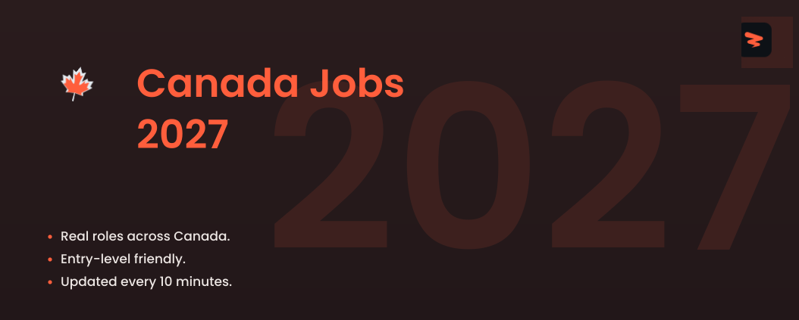

<!-- Cover -->

# Canada Jobs 2027

🚀 Entry-level, new-grad, and early-career jobs across Canada, sourced live and updated every 10 minutes.

  
  
  
  

---

## **Website & Autofill Extension**

Explore Zapply's website and check out:

- Our Chrome extension, which autofills job applications in seconds.
- A dedicated job board featuring the latest openings across various roles.
- User accounts with multiple profiles for different resume types and roles.
- Job application tracking with streaks and commitment awards.

Experience an advanced career journey with us! 🚀

  

## Explore Around

Connect and seek advice from a growing network of fellow students and new grads.

  
  &nbsp;&nbsp;
  

---

 

<h3>💻 <strong>Software Engineering</strong></h3>

| Company | Role | Location | Posted | Visa | **Apply** |
|---------|------|----------|--------|------|----------|
| **Manulife** | Back-End Software Engineer | Toronto | 2h |  |  |
| **Johnson Controls** | Controls Systems Engineer / Systems Designer | Ottawa-Ontario-Canada | 1d |  |  |
| **Johnson Controls** | Security Project Manager | Brampton-Ontario-Canada | 1d |  |  |
| **Manulife** | Full-Stack Software Engineer (C#, .Net, React) | Waterloo Ontario +1 more | 1d |  |  |
| **BMO** | AI Developer | Toronto, ON | 1d |  |  |
| **Microsoft** | Cloud Solution Architect - AI Apps | Vancouver, BC | 1d |  |  |
| **Johnson Controls** | Security Systems Installation Technician | Ottawa-Ontario-Canada | 1d |  |  |
| **Affirm** | Software Engineer II, Backend | Canada | 1d |  |  |
| **NTT Data** | Oracle EBS Technical - Developer | Calgary, AB | 1d |  |  |
| **Cohere** | Software Engineer, ML Workload Platform | Remote | 1d |  |  |
| **Lumentum** | Process Automation Software Engineer - MEMS | Canada - Ottawa | 2d |  |  |
| **Cisco** | Software Developer Full Stack / Backend I (Co-op) - Canada | Kanata Ontario Canada +7 more | 2d |  |  |
| **Cisco** | Software Developer Embedded Systems II (Co-op) – Canada | Kanata Ontario Canada +6 more | 2d |  |  |
| **Cisco** | Software Developer Embedded Systems I (Co-op) - Canada | Kanata Ontario Canada +5 more | 2d |  |  |
| **Canadian Tire** | Compliance & Security Specialist | Oakville, ON | 2d | ✅ Sponsor |  |
| **TD Bank** | Mobile Software Engineer I (iOS) | Toronto | 2d |  |  |
| **TD Bank** | Software Engineer II | Toronto | 2d |  |  |
| **Citi** | Java Full Stack Developer | Mississauga Ontario Canada | 2d |  |  |
| **BMO** | Quantitative Developer, Global Asset Management | Toronto, ON | 2d |  |  |
| **Amazon Development Centre Canada ULC** | Software Development Engineer II, Intelligent Cloud Hosting (ICON) | Vancouver, BC | 2d | ✅ Sponsor |  |
| **Amazon Development Centre Canada ULC** | Software Development Engineer II, Intelligent Cloud Hosting (ICON) | Vancouver, BC | 2d | ✅ Sponsor |  |
| **Amazon Development Centre Canada ULC** | Software Development Engineer III, Intelligent Cloud Hosting (ICON) | Vancouver, BC | 2d | ✅ Sponsor |  |
| **Qualcomm** | AI and DSP Applications Software Engineer | Markham | 2d |  |  |
| **Fortinet** | Early Careers: Technical Content DevOps Developer | Burnaby, BC | 2d |  |  |
| **Carfax** | Software Engineer | London | 2d |  |  |
| **DRW** | Software Developer | Montreal | 2d |  |  |
| **Capco** | Developer | Canada - Toronto | 2d |  |  |
| **BMO** | Cloud solution Developer | Toronto, ON | 2d |  |  |
| **Asana** | Security Risk Engineer | Vancouver, BC | 2d |  |  |
| **Tailscale** | Security Software Engineer | Canada | 2d |  |  |
| **Nasdaq** | Software Developer Specialist | Toronto, CA | 3d |  |  |
| **TD Synnex** | Business Development Representative - Microsoft Cloud Software (SAAS)   Représentant du... | Montreal, PQ | 3d |  |  |
| **TD Bank** | Software Engineer II (Systems Support) | Toronto | 3d |  |  |
| **Citi** | Backend Java Developer | Ontario Canada | 3d |  |  |
| **Teledyne** | Software Engineering Coop | Canada - Waterloo, ON | 3d |  |  |
| **Viavi Solutions** | Software Systems Engineer - Interferometry/microscopy | Ottawa | 3d |  |  |
| **Microsoft** | Cloud & AI Solution Engineer - Azure Platform | Toronto, ON | 3d |  |  |
| **Microsoft** | Solution Engineer - Cloud & AI Applications | Toronto, ON | 3d |  |  |
| **Salesforce** | Customer Success Manager - Core Clouds | Canada Toronto +1 more | 3d |  |  |
| **Qualcomm** | Software Engineer, Machine Learning | Markham | 3d |  |  |
| **Qualcomm** | FY27 Intern - Telemetry Firmware, Driver and Tools Developer Internship - Canada (16 months) | Markham | 3d |  |  |
| **Kent Building Supplies** | Security Analyst | Saint John, NB | 3d |  |  |
| **NTT Data** | OnBase API Developer - Remote Canada Position | Toronto, ON | 3d |  |  |
| **Mozilla** | iOS Software Engineer | Canada | 3d |  |  |
| **Citi** | Applications Development AI Developer, Assistant Vice President | Mississauga Ontario Canada | 4d |  |  |
| **Arlo** | Firmware Developer Co-op | Richmond, BC | 4d |  |  |
| **Manulife** | Full Stack Engineer | Waterloo Ontario +1 more | 4d |  |  |
| **Mastercard** | Software Engineer II | Vancouver | 4d |  |  |
| **Lyft** | Software Engineer, Backend | Toronto | 4d |  |  |
| **Sopra Steria** | Embedded Software Test Engineer / HSIT – ISO 26262 | Ottawa, ON | 4d |  |  |
| **Eaton** | Développeur(euse) Logiciel C++ / Software Developer C++ | Brossard | 4d |  |  |
| **Robinhood** | Software Engineer, International Expansion | Toronto | 4d |  |  |
| **Danaher** | Salesforce Field Service (FSL) Developer | Concord | 5d |  |  |
| **Amazon Web Services Canada, Inc.** | AI Security Engineer, AWS Security - AISec | Nova Scotia, NS | 5d | ✅ Sponsor |  |
| **NTT Data** | Java + SQL + Angular Developer | Toronto, ON | 5d |  |  |
| **Robinhood** | Applications Developer, Workday | Toronto | 5d |  |  |
| **Blue J** | Software Developer - Applied AI | Toronto | 5d |  |  |
| **Google** | Software Developer II, Early Career | Canada | Date unknown |  |  |
| **SS&C Technologies** | AI Software Engineer | Ontario | 6d |  |  |
| **SS&C Technologies** | AI Software Engineer | Ontario | 6d |  |  |
| **S&P Global** | Software Engineer – Full-Stack (React, TypeScript, Java) | Toronto | 6d |  |  |
| **Danaher** | Salesforce Field Service (FSL) Developer | Concord | 6d |  |  |
| **Ecolab** | Software Engineer | Calgary | 1w |  |  |
| **CIBC** | Corporate Security Coordinator Co-op | Toronto, ON | 1w |  |  |
| **Zebra** | Software Engineer II | Montreal | 1w |  |  |
| **Trane Technologies** | Project Developer | Laval | 1w |  |  |
| **Salesforce** | Solutions Architect, Salesforce Migrations (Data360, Revenue, Tableau, or Marketing Clouds) | Canada Toronto +2 more | 1w |  |  |
| **Apple** | Software Engineer, Xcode Cloud | Vancouver | 1w |  |  |
| **Airbyte** | Customer Support Developer (Databases) | Remote | 1w |  |  |
| **Affirm** | Software Engineer II, Full Stack (Card Pre-Swipe Experience) | Canada | 1w |  |  |
| **MaintainX** | Integrations Developer | Toronto | 1w |  |  |
| **MaintainX** | Integrations Developer | Montreal | 1w |  |  |
| **1Password** | Developer, Enterprise Tenants and Policies | Remote | 1w |  |  |
| **Wealthsimple** | Security Incident Response Developer | Remote | 1w |  |  |
| **CIBC** | Full Stack Developer (.NET, C#, SQL, React, and Azure Databricks) | Toronto, ON | 1w |  |  |
| **Capital One** | Associate, Software Engineer, New Grad Card Expansion | Toronto, ON | 1w |  |  |
| **Google** | Software Developer, Apple Build Rules | Canada | Date unknown |  |  |
| **Google** | AI Outcome Customer Developer, Forward Deployed Development | Canada | Date unknown |  |  |
| **NVIDIA** | Developer Relations Manager, Higher Education and Research - Foundational AI | Canada | 1w |  |  |
| **Altera** | Software Engineer - Factory Apps - Intern | Toronto | 1w |  |  |
| **General Motors** | Early Career Software Test Developer - Propulsion Thermal Management | Markham | 1w |  |  |
| **GitLab** | Backend Engineer, Source Code: Repository Services (Ruby) | Canada | 1w |  |  |
| **MaintainX** | Full-Stack Developer - IAM | Montreal +1 more | 1w |  |  |
| **Lyft** | Software Engineer, AI Entries | Toronto | 1w |  |  |
| **Zebra** | Computer Vision Software Developer, Professional II- Développeur ou Développeuse de Logiciels en... | Montreal | 1w |  |  |
| **Mastercard** | Manager, Regional Product Management (Security Solutions) | Toronto | 1w |  |  |
| **Stantec** | Intermediate Power Systems Engineer | Fredericton, NB | 1w | ✅ Sponsor |  |
| **Carfax** | Manager - Software Engineering | London | 1w |  |  |
| **Fortinet** | Presales Security Expert Public Sector | Montreal, QC | 1w |  |  |
| **Xsolla** | Junior Frontend Developer, Custom Webshop Development | Montreal | 1w |  |  |
| **Aptiv** | Cloud Engineering Intern | CAN Kanata (2), ON | 1w |  |  |
| **BlackBerry** | QNX Systems Software Developer | Ottawa | 1w |  |  |
| **CIBC** | Consultant, Java Back End Developer | Toronto, ON | 1w |  |  |
| **Fortinet** | React JS Developer | Burnaby, BC | 1w |  |  |
| **Wealthsimple** | Team Lead, Client Experience Operations (Risk and Security) | Remote | 1w |  |  |
| **Cohere** | Web Developer | Toronto +6 more | 1w |  |  |
| **Mastercard** | Software Engineer - II | Vancouver | 1w |  |  |
| **Motorola Solutions** | Localization and QA Automation Developer Co-Op | Vancouver | 1w |  |  |
| **MongoDB** | Software Engineer 3, Identity and Access Management | Toronto | 1w |  |  |
| **Affirm** | Product Security Engineer II - IAM | Canada | 1w |  |  |

Apply for more jobs at

<h3>⚙️ <strong>Hardware & Systems</strong></h3>

| Company | Role | Location | Posted | Visa | **Apply** |
|---------|------|----------|--------|------|----------|
| **ABB** | Project Electrical Designer | Milton | 1d |  |  |
| **Johnson Controls** | QC Electrical Inspector | Nisku-Alberta-Canada | 1d |  |  |
| **Microsoft** | Critical Environment Electrical Engineering | Toronto, ON | 1d |  |  |
| **Semtech** | Test Engineering Intern | CAN - Burlington, ON | 2d |  |  |
| **Intel** | GPU Validation Engineer | Canada | 2d |  |  |
| **Intel** | Graphics Hardware Validation Undergraduate Engineering Intern | Canada | 2d |  |  |
| **Qualcomm** | FY27 Intern - Software Validation Engineering Internship - Canada (16 months) | Markham | 2d |  |  |
| **Stantec** | Electrical EIT- Water | Edmonton, AB | 2d | ✅ Sponsor |  |
| **Eaton** | Electrical Assembler | Airdrie | 2d |  |  |
| **Lumentum** | FPGA Designer | Canada - Ottawa | 3d |  |  |
| **Thermo Fisher Scientific** | Validation Engineering Specialist II | Whitby | 3d |  |  |
| **Stantec** | Intermediate Electrical Engineer | Dartmouth, NS | 3d | ✅ Sponsor |  |
| **WSP** | Electrical and Controls Drafter/Designer, Power Generation | Calgary, AB | 3d | ✅ Sponsor |  |
| **WSP** | Intermediate Electrical Engineer (Sudbury) | Sudbury, ON | 3d | ✅ Sponsor |  |
| **WSP** | Electrical Engineer-in-Training (Sudbury) | Sudbury, ON | 3d | ✅ Sponsor |  |
| **Arlo** | Hardware Engineer Co-op | Richmond, BC | 4d |  |  |
| **Qualcomm** | FY27 Intern - Display IP FPGA Emulation Intern - Canada (4 months) | Markham | 4d |  |  |
| **Johnson Controls** | Electrical Apprentice 1st | Nisku-Alberta-Canada | 4d |  |  |
| **Arlo** | Hardware Engineer | Richmond, BC | 5d |  |  |
| **Qualcomm** | Optical Systems Validation Engineer | Ottawa | 5d |  |  |
| **Ecolab** | Electrical Assembler | Calgary | 6d |  |  |
| **Curtiss-Wright** | Electrical Manufacturing Engineer | Canada-Stratford | 1w |  |  |
| **Altera** | FPGA Development Tools - Intern | Toronto | 1w |  |  |
| **D-Wave Quantum** | Electrical Production Technician II \[646\] | Burnaby | Date unknown |  |  |
| **NVIDIA** | ASIC Verification Intern - Summer 2027 | Canada | 1w |  |  |
| **Johnson Controls** | HVAC Electrical Installer | Calgary-Alberta-Canada | 1w |  |  |
| **TD Bank** | Data Scientist I (Quants) – Insurance Model Validation | Toronto | 1w |  |  |
| **TD Bank** | Data Scientist I (Quants) – Insurance Model Validation | Toronto | 1w |  |  |
| **TD Bank** | Manager, Advanced Analytic, Insurance Model Validations  (Quants) | Toronto | 1w |  |  |
| **Kent Building Supplies** | Department Manager of Electrical/Plumbing/Hardware/Seasonal/Garden Centre | Dartmouth, NS | 1w |  |  |
| **Hitachi** | Ingénieur(e) en conception électrique / Electrical Design Engineer | Varennes | 1w |  |  |
| **Sopra Steria** | Hardware Engineer – Aerospace | Montréal, QC | 1w |  |  |
| **Nokia** | Electrical Engineering Student | Canada | 1w | ✅ Sponsor |  |
| **Eaton** | Electrical Assembler - Load Center line | Perth | 1w |  |  |
| **Lumentum** | Automation and Test Engineer - Photonics | Canada - Ottawa | 1w |  |  |
| **Danaher** | Intermediate Electrical Designer/Engineer | Concord | 1w |  |  |
| **Danaher** | Electrical Engineering Technologist | Concord | 1w |  |  |
| **Intel** | Pre-Si Validation Engineer | Canada | 1w |  |  |
| **Eaton** | Power Systems Automation Specialist/ Spécialiste en automatisation des systèmes électriques | Mississauga +5 more | 1w |  |  |
| **Veolia Environnement SA** | Electrical & Instrumentation Engineer | Oakville, ON | 1w |  |  |
| **Danaher** | Electrical Engineering Technologist | Concord | 1w |  |  |
| **Kent Building Supplies** | Department Manager - Lighting/Electrical/Plumbing | Fredericton, NB | 1w |  |  |
| **Trimble** | Automated Test Engineering Intern (16-Month Internship) | Canada - Richmond Hill | 2w |  |  |
| **Stantec** | Electrical Engineering Intern – Buildings (Winter 2027) - 8 Month Term | Edmonton, AB | 3w | ✅ Sponsor |  |
| **Lumentum** | Electrical Engineer Co-op/Intern | Canada - Ottawa | 3w |  |  |
| **Marvell** | IC Validation Engineer Intern - BS/MS - 2027 Co-Op | Ottawa | 1mo |  |  |
| **Marvell** | Data Center Silicon Hardware Engineering Intern - BS - 2027 Co-Op | Ottawa Canada +1 more | 1mo |  |  |
| **Semtech** | Validation Engineering Intern | CAN - Ottawa, ON | 1mo |  |  |
| **Hitachi** | Hardware Test Engineering Intern (Summer 2027, 16months) | Toronto | 1mo |  |  |
| **Thermo Fisher Scientific** | Validation Engineering Co-op | Mississauga | 1mo |  |  |
| **Hitachi** | Electrical Component Engineering Intern (Summer 2027, 16months) | Toronto | 1mo |  |  |
| **Fluor** | Electrical & Instrumentation Estimator | Vancouver | 1mo |  |  |
| **Fluor** | Electrical Engineer - Intermediate - Mining & Metals | Vancouver | 1mo |  |  |
| **Fluor** | Electrical Design Supervisor | Vancouver +1 more | 1mo |  |  |
| **Rocket Lab** | Electrical Engineering Intern Summer 2027 | Toronto | 1mo |  |  |
| **Rocket Lab** | Electrical Engineering Intern Spring 2027 | Toronto | 1mo |  |  |
| **Kent Building Supplies** | Electrical Engineering Student - Pulp & Paper Division - Winter 2027 | Saint John, NB | 2026-09-08 |  |  |

Apply for more jobs at

<h3>🔬 <strong>Data Science & Analytics</strong></h3>

| Company | Role | Location | Posted | Visa | **Apply** |
|---------|------|----------|--------|------|----------|
| **CIBC** | Quantum Machine Learning Research Scientist | Toronto, ON | 1d |  |  |
| **TD Bank** | Technical Product Owner,  AI & Machine Learning Solutions | Toronto | 1d |  |  |
| **TD Bank** | AVP, Legal - Technology Enablement, Data Analytics and Reporting | Toronto | 1d |  |  |
| **BMO** | Manager, Reporting & Analytics | Toronto, ON | 1d |  |  |
| **BMO** | Associate, Portfolio Analytics | Toronto, ON | 1d |  |  |
| **Apple** | Machine Learning Engineer, Evaluation and Quality, Creativity Apps | Vancouver | 1d |  |  |
| **S&P Global** | Summer intern, Financial Risk Analytics Product | Toronto | 2d |  |  |
| **Canadian Tire** | Data Analyst | Laval, QC | 2d | ✅ Sponsor |  |
| **Capital One** | Intern, Strategy Analyst - Summer 2027 | Toronto, ON | 2d |  |  |
| **Capital One** | Associate, Strategy Analyst - New Grad 2027 | Toronto, ON | 2d |  |  |
| **BMO** | Data Scientist | Toronto, ON | 2d |  |  |
| **Canadian Tire** | Data Analyst – Center of Excellence & Data Analytics | Toronto, ON | 3d | ✅ Sponsor |  |
| **CIBC** | Consultant, Business Analytics | Toronto, ON | 3d |  |  |
| **Qualcomm** | Engineer, AI Software/Machine Learning (C++) | Markham | 3d |  |  |
| **Stripe** | Manager, Marketing Analytics | Toronto | 3d | ✅ Sponsor |  |
| **TD Bank** | Data Scientist - Credit Risk (ATH 5749) | Toronto | 3d |  |  |
| **Qualcomm** | FY27 Intern - Machine Learning Engineering Internship - Canada (4 months) | Markham | 4d |  |  |
| **Lightspeed** | Ingénieur(e) Analytics Sénior | Montreal | 5d |  |  |
| **Stripe** | Data Scientist, FX Quantitative Research | Toronto | 5d | ✅ Sponsor |  |
| **Eurofins** | Research Scientist - Organic Chemist - Eurofins CDMO Alphora, Inc. | Mississauga, ON | 5d |  |  |
| **GitLab** | Data Scientist, Enterprise Analytics | United States +1 more | 1w |  |  |
| **Stripe** | PhD Machine Learning Engineer, Intern | Toronto | 1w | ✅ Sponsor |  |
| **Kent Building Supplies** | Junior Data Analyst | Halifax, NS | 1w |  |  |
| **ShyftLabs** | Forward - Data Visualization & Analytics Specialist | Toronto | 1w |  |  |
| **Manulife** | Operations & Data Analyst Co-op (8 Months) | Waterloo Ontario +1 more | 1w |  |  |
| **CIBC** | Data Analyst co-op | Toronto, ON | 1w |  |  |
| **Manulife** | Winter Co-op 2027 - Data & Analytics | Toronto | 1w |  |  |
| **Kent Building Supplies** | Data Analyst Student – Winter 2027 | Saint John, NB | 1w |  |  |
| **Kent Building Supplies** | Business Analytics & Transformation Analyst | Saint John, NB | 1w |  |  |
| **Trimble** | Firmware & Machine Learning Engineering Intern (16 Months) | Canada - Richmond Hill | 1w |  |  |
| **Cardinal Health** | Compliance and Analytics Specialist | Canada NSC +1 more | 1w |  |  |
| **Qualcomm** | FY27 Intern - Machine Learning AISW Internship - Canada (4 Months) | Markham | 1w |  |  |
| **Lumentum** | Optical Algorithms and Analytics Engineering Co-op/Intern | Canada - Ottawa | 2w |  |  |
| **Affirm** | Machine Learning Engineer II (ROA + LTV ML) | Canada | 3w |  |  |
| **Tower Research Capital** | Machine Learning Intern | Montreal | 3w | ✅ Sponsor |  |
| **Asana** | Data Scientist | Vancouver, BC | 3w |  |  |
| **Microsoft** | Stagiaire en recherche - apprentissage automatique; Research Intern - Machine Learning | Montreal, QC | 3w |  |  |
| **Manulife** | Winter Co-op 2027 - ALM Data Management & Analytics | Toronto | 1mo |  |  |
| **Pinterest** | Machine Learning Intern 2027 (Toronto) | Toronto, ON | 1mo |  |  |
| **Nokia** | Operations Analytics Co-op/Intern | Canada | 1mo | ✅ Sponsor |  |
| **OpenTable** | Manager, Marketing Analytics | Toronto | 1mo |  |  |
| **OpenTable** | Applied Machine Learning Scientist II | Toronto | 2026-09-04 |  |  |
| **DRW** | Junior Data Analyst | Montreal | 2026-08-13 |  |  |
| **Squarepoint Capital** | Finance Data Analyst | Montreal | 2026-08-13 |  |  |
| **Epic Games** | Machine Learning Programmer, Memory | Montreal, QC | 2026-08-12 |  |  |
| **Epic Games** | Machine Learning Intern | Montreal, QC | 2026-08-07 |  |  |
| **Affirm** | Machine Learning Engineer II (Underwriting ML) | Canada | 2026-08-06 |  |  |
| **Scale AI** | Machine Learning Fellow - Human Frontier Collective (Canada) | Canada | 2026-02-13 |  |  |
| **Pinterest** | Machine Learning Engineer II, Core Engineering | Toronto, ON | 2025-12-23 |  |  |
| **Cresta** | Machine Learning Engineering Intern | Toronto | 2024-09-11 |  |  |

Apply for more jobs at

<h3>🤖 <strong>AI / ML</strong></h3>

| Company | Role | Location | Posted | Visa | **Apply** |
|---------|------|----------|--------|------|----------|
| **CIBC** | Financial Advisor-CIRO-MFD/AMF (Relocation Assistance Available) | Fernie, BC | 1d |  |  |
| **Canadian Tire** | Account Coordinator, Triangle Retail Media | Toronto, ON | 1d | ✅ Sponsor |  |
| **Johnson Controls** | Performance Engineer, Sustainability Infrastructure Services | Richmond Hill-Ontario-Canada | 1d |  |  |
| **Live Nation** | Paid Media Coordinator | Vancouver, BC | 1d |  |  |
| **TD Bank** | PBA Trainee- Mandarin/ Cantonese/ Korean , Language Skills as an Asset | Edmonton | 1d |  |  |
| **TD Bank** | Personal Banking Associate Trainee - Montreal-Est | Montréal | 1d |  |  |
| **TD Bank** | Personal Banking Associate Trainee (Full time) - Saint-Jérôme | Saint-Jérôme | 1d |  |  |
| **Johnson Controls** | BEST Technical Sales Trainee - Equipment - Toronto, ON | Richmond Hill-Ontario-Canada | 1d |  |  |
| **UPS** | Early AM Warehouse Associate - Kamloops | KAMLOOPS | 1d |  |  |
| **UPS** | Early Morning Preload - Kamloops | KAMLOOPS | 1d |  |  |
| **UPS** | Air Walker | MOUNT PEARL | 1d |  |  |
| **Red Bull** | Sales Trainee - Contract | Ottawa, ON | 1d |  |  |
| **Trimble** | AI Software Development Engineer in Test | Canada - Kamloops, BC | 2d |  |  |
| **Cardinal Health** | Coordinateur (e) d'inventaire | Canada-Dorval | 2d |  |  |
| **AstraZeneca** | Production Planner, Supply Chain Planning | Canada – Hamilton – Longwood... | 2d |  |  |
| **General Mills** | Maintenance Electrician | Winnipeg, MB | 2d |  |  |
| **Regal Rexnord** | Fulfillment Coordinator II | Mississauga | 2d |  |  |
| **Capital One** | Manager, Performance Marketing - Paid Search & Display | Toronto, ON | 2d |  |  |
| **Citi** | AI-Augmented Automation Engineer (Java & Selenium/Playwright) | Mississauga Ontario Canada | 2d |  |  |
| **BMO** | Manager, Sustainability Disclosure & Impact | Toronto, ON | 2d |  |  |
| **Amazon Development Centre Canada ULC** | Software Development Engineer, Edgelink ML, Amazon Traffic Engineering | Vancouver, BC | 2d | ✅ Sponsor |  |
| **WSP** | Administrative Assistant, Supply Chain Management | Calgary, AB | 2d | ✅ Sponsor |  |
| **Microsoft** | Gestionnaire de programme - opérations financières / Program Manager - Financial Business Operations | Quebec City, QC | 2d |  |  |
| **Beacon Software** | AI Strategist | Toronto, ON | 2d |  |  |
| **AbbVie** | Chef, Capacités d'excellence de l'équipe sur le terrain | Montreal, QC | 2d |  |  |
| **BMO** | CAD Complaints Specialist | MONTREAL, QC | 2d |  |  |
| **Capco** | AI Integration Engineer – Market Data & Entitlements | Canada - Toronto | 2d |  |  |
| **Capco** | AI Engineer – Market Surveillance | Canada - Toronto | 2d |  |  |
| **Capco** | AI Engineer – Corporate Actions & Asset Servicing | Canada - Toronto | 2d |  |  |
| **Veolia Environnement SA** | Maintenance & Project Manager | Pickering, ON | 2d |  |  |
| **Hitachi** | Ingénieur de projets – Protection et contrôle de postes électriques (secondaire)   Project... | Saint-Laurent | 3d |  |  |
| **Nike** | Retail Associate, PT - Nike Vaughan Mills | Concord | 3d |  |  |
| **Nike** | Retail Associate, FT - Nike Vaughan Mills | Concord | 3d |  |  |
| **Nike** | Retail Associate, FT - Nike Kanata | Ottawa | 3d |  |  |
| **CIBC** | Business Coordinator for Vice Chair | Toronto, ON | 3d |  |  |
| **Avis Budget Group** | Car Detailer - Full Time | 1 Convair Dr East, ON | 3d |  |  |
| **Avis Budget Group** | Car Detailer - Part Time | 1 Convair Dr East, ON | 3d |  |  |
| **TD Synnex** | R56790 Business Analyst III - Artificial Intelligence | Mississauga | 3d |  |  |
| **RTX** | Stage - Hiver 2027 - Stagiaire aux affaires corporatives / Internship - Winter 2027 - Corporate... | Qc, CA | 3d |  |  |
| **Manulife** | Life Underwriting Trainee | Canada | 3d |  |  |
| **Medtronic** | Training & Education Specialist | Brampton | 3d |  |  |
| **BMO** | Business Banking Relationship Manager Trainee | Lloydminster, AB | 3d |  |  |
| **Starbucks** | barista - Store# 04673, TSAIN-KO VILLAGE SECHELT | 5500 Sunshine Coast Highway | 3d |  |  |
| **Starbucks** | barista - Store# 85890, SAINT-CHARLES-BORROMEE | 130 Rue De La Visitation | 3d |  |  |
| **Intel** | Compiler Engineer for AI Tile-based DSL | Canada | 3d |  |  |
| **Philips** | Sales, Territory Manager/ Gestionnaire de territoire, ventes – Soins buccodentaires (Rive-Sud de... | Montreal | 3d |  |  |
| **WSP** | Gestionnaire de projet sénior - Hydroélectricité & Barrages (Sécurité des barrages) | Montreal, QC | 3d | ✅ Sponsor |  |
| **WSP** | Structural Engineer-in-Training (Sudbury) | Sudbury, ON | 3d | ✅ Sponsor |  |
| **Kent Building Supplies** | Corporate Sustainability Manager | Toronto, ON | 3d |  |  |
| **Kent Building Supplies** | Production Controller- Ship Repair | Halifax, NS | 3d |  |  |
| **Sherwin-Williams** | Management and Sales Trainee | Winnipeg, MB | 3d |  |  |
| **Sherwin-Williams** | Management and Sales Trainee | Regina, SK | 3d |  |  |
| **Sherwin-Williams** | Assistant Sales Trainee Manager | Regina, SK | 3d |  |  |
| **Veolia Environnement SA** | Maintenance Cleaner | Edmonton, AB | 3d |  |  |
| **AbbVie** | Medical Science Liaison , Solid Tumour, Western Canada | Vancouver, BC | 3d |  |  |
| **Boston Scientific** | R&D Product Development Intern /   Stagiaire en recherche et développement (R-D) - Développement de | Montreal CA-QC | 3d |  |  |
| **CIBC** | Campaign Growth Analyst – Simplii Financial | Toronto, ON | 3d |  |  |
| **Cardinal Health** | Associé (e) d'entrepôt- sur contrat-temporaire | Canada-Dorval | 4d |  |  |
| **Teledyne** | Stagiaire en tests thermiques/ Thermal Test Co-op | Canada - Montreal, QC | 4d |  |  |
| **Teledyne** | Gestionnaire de projets Industrialisation | Canada - Bromont, QC | 4d |  |  |
| **Fresenius Medical Care** | Quality Complaints Specialist (Bilingual) | Richmond Hill, ON | 4d |  |  |
| **Thermo Fisher Scientific** | Compliance Specialist II - Regulatory Affairs | Ottawa | 4d |  |  |
| **Thermo Fisher Scientific** | Compliance Specialist II - Regulatory Affairs - 12 month fixed term contract | Ottawa | 4d |  |  |
| **DRW** | AI Enablement Engineer | Montreal | 4d |  |  |
| **Veolia Environnement SA** | Customer Fulfillment Representative | Oakville, ON | 4d |  |  |
| **Sopra Steria** | Software Safety Engineer – AI, LLM & SW-FMEA Automation | Montréal, QC | 4d |  |  |
| **Moderna** | Co-Op, Supply Chain Planning | Laval - Canada | 5d |  |  |
| **Boeing** | Aircraft Mechanic AME M2 (C-17) | CAN CFB Trenton Canada +7 more | 5d |  |  |
| **Avis Budget Group** | gestionnaire de la remise en marché des véhicules   Remarketing Manager | 850 Jean Paul Laframboise, QC | 5d |  |  |
| **TD Synnex** | Vendor Business Manager, HPI Personal Systems and Services   Gestionnaire des affaires... | Mississauga | 5d |  |  |
| **Nissan** | Technical Trainer (Central Region) | Mississauga | 5d |  |  |
| **HPE** | Named Accounts Manager - Networking / Gestionnaire de comptes nommés - Réseau | Montreal | 5d |  |  |
| **Intel** | Compiler Engineer for Tile-based AI DSLs | Canada | 5d |  |  |
| **Intel** | GPU & AI Accelerator Hardware Design Undergraduate Intern | Canada | 5d |  |  |
| **Qualcomm** | FY27 Intern - AI Software Systems Co-op - Canada (4 months) | Toronto | 5d |  |  |
| **Stantec** | Technicienne / Technicien conception, Infrastructures urbaines | Amos, QC | 5d | ✅ Sponsor |  |
| **Microsoft** | Stagiaire - Technicien de Centre de Données (TI) / Datacenter Technician - Intern (IT) | Quebec City, QC | 5d |  |  |
| **Microsoft** | Stagiaire en opérations critiques Centre de données / Critical Environment Ops INTERN Data Center | Quebec City, QC | 5d |  |  |
| **HPE (University)** | Named Accounts Manager - Networking / Gestionnaire de comptes nommés - Réseau | Montreal | 6d |  |  |
| **NCR Voyix** | Field Service Technician I - Grand Prairie, AB | ALBERTA VIRTUAL | 6d |  |  |
| **Boeing** | Aircraft Mechanic (CH147F) | CAN Petawawa Canada +6 more | 6d |  |  |
| **Boeing** | Aircraft Avionics Technician (CH147F) | CAN Petawawa Canada +6 more | 6d |  |  |
| **NTT Data** | Oracle Fusion & EBS Supply Chain Solution Architect  - Remote | Toronto, ON | 6d |  |  |
| **Kent Building Supplies** | Finance AI Analyst Student - Winter 2027 | Dieppe, NB | 6d |  |  |
| **Stantec** | Junior Sustainability Analyst | Ottawa, ON | 6d | ✅ Sponsor |  |
| **JLL** | Assistant Maintenance Manager | Pitt Meadows, BC | 1w |  |  |
| **Carrier Global** | Gestionnaire de comptes - Automatisation du bâtiment | LOC13127 3493 Rue Ashby, QC | 1w |  |  |
| **Pfizer** | Gestionnaire de comptes - Pharmacies/Pharmacy Key Account Manager , Secteur hospitalier et... | QC | 1w |  |  |
| **Starbucks** | barista - Store# 17203, 1341 MAIN ST W | 1341 Main St W | 1w |  |  |
| **HPE** | HPC & AI Software - Engineering Resolution Engineer | Mississauga | 1w |  |  |
| **Hitachi** | Supply Chain Intern (Winter 2027 - 12 months) | Toronto | 1w |  |  |
| **Lightspeed** | Chargé(e) de compte, Paiements | Montreal | 1w |  |  |
| **Capital One** | Sr. Associate, AI Engineer | Toronto, ON | 1w |  |  |
| **NVIDIA** | PhD Research Intern, Quantum and AI for Chemistry - 2027 | Canada | 1w |  |  |
| **Cardinal Health** | Coordinateur (e) d'inventaire | Canada-Dorval | 1w |  |  |
| **Workday Inc** | Software Development Engineer in Test, Evisort AI | BC | 1w |  |  |
| **Fiserv** | Production Fulfillment Associate | Mississauga - Export | 1w |  |  |
| **Manulife** | AVP, AI | Toronto | 1w |  |  |
| **Pfizer** | Gestionnaire – Clients institutionnels (GCI) /Institutional Key Account Manager - Secteur... | QC | 1w |  |  |
| **Pfizer** | Health Science Representative - Primary Care / Représentant - Sciences de la santé - Soins... | Canada Ontario +2 more | 1w |  |  |

Apply for more jobs at

<h3>🛠️ <strong>Operations & Support</strong></h3>

| Company | Role | Location | Posted | Visa | **Apply** |
|---------|------|----------|--------|------|----------|
| **Caterpillar** | Sales Support & Marketing Intern | Tullamarine | 1d |  |  |
| **Citi** | Apps Support Intmd Analyst - Officer | Mississauga Ontario Canada | 1d |  |  |
| **Canadian Tire** | Analyst, Procure to Pay Operations | Oakville, ON | 1d | ✅ Sponsor |  |
| **ABB** | ABB Discovery Program - Commercial Operations | Iberville | 1d |  |  |
| **TD Bank** | Operations Analyst II - Western Field Auditor - (ATHN 461) | Calgary | 1d |  |  |
| **TD Bank** | AVP, Legal - Operations and Business Management | Toronto | 1d |  |  |
| **Thermo Fisher Scientific** | Scientific Technical Writer I - Lab Operations | Whitby | 1d |  |  |
| **Citi** | Technology, Production Support, Full Time Analyst, Mississauga, Canada, 2027 | Mississauga Ontario Canada | 1d |  |  |
| **UPS** | Seasonal Support Driver | FREDERICTON | 1d |  |  |
| **UPS** | Seasonal Support Driver | SYDNEY | 1d |  |  |
| **UPS** | Seasonal Support Driver | SAINT JOHN | 1d |  |  |
| **GitLab** | Professional Services, Program Manager | United States +1 more | 1d |  |  |
| **Magna** | Program Manager (Hot Form) | Brampton, CA | 1d |  |  |
| **Motorola Solutions** | Back Office Support Specialist | Vancouver | 2d |  |  |
| **Canadian Tire** | Instore Brand Program Manager - 12 Month Contract | Calgary, AB | 2d | ✅ Sponsor |  |
| **Canadian Tire** | Assistant Manager, Operations, Hoover Park Drive | Stouffville, ON | 2d | ✅ Sponsor |  |
| **Amgen** | Graduate Intern – R&D Execution, Operations & Strategy (R&D EOS) | Canada - Burnaby | 2d |  |  |
| **TD Bank** | IT Operations Analyst IV | Toronto | 2d |  |  |
| **RTX** | Stage- Gestion des Programmes Moteurs – Introduction de Nouveau produit  / Internship-... | Qc, CA | 2d |  |  |
| **Manulife** | Project Manager, Group Benefits Operations | Waterloo | 2d |  |  |
| **Dropbox** | Legal Operations Associate | Canada: Select locations | 2d |  |  |
| **Hitachi** | Field Service Representative | Kelowna | 3d |  |  |
| **Hitachi** | Qualified Electric Worker - Field Services | British Columbia Canada +2 more | 3d |  |  |
| **ABB** | Field Service Technician | Sudbury Ontario Canada +3 more | 3d |  |  |
| **RTX** | Stage - Gestion des Programmes - Hiver 2027 Internship - Operations Program Management - Winter 2027 | Qc, CA | 3d |  |  |
| **Citi** | Applications Support Sr Analyst - Assistant Vice President | Mississauga Ontario Canada | 3d |  |  |
| **BMO** | Centralized Support Assistant, Nesbitt Burns | QC | 3d |  |  |
| **BMO** | Centralized Support Associate, Nesbitt Burns | QC | 3d |  |  |
| **BMO** | Branch Operations Administrator/Receptionist | Victoria, BC | 3d |  |  |
| **Vertiv** | Field Service Representative - Power | Toronto, ON | 3d |  |  |
| **Amazon Development Centre Canada ULC** | Software Support Engineer, AFT Quality | Toronto, ON | 3d | ✅ Sponsor |  |
| **Magnet Forensics** | Technical Support Engineer | Vancouver | 3d |  |  |
| **Lightspeed** | Billing Support Specialist | Montreal | 3d |  |  |
| **Benevity** | GTM Operations Analyst | Toronto, ON | 3d |  |  |
| **Benevity** | GTM Operations Analyst | Calgary, AB +1 more | 3d |  |  |
| **Benevity** | Client Technical Support Specialist - Term | Toronto, ON | 3d |  |  |
| **Trimble** | Product Support Analyst | Canada - Richmond Hill | 4d |  |  |
| **ABB** | Field Service Engineer | Coquitlam | 4d |  |  |
| **Salesforce** | Product Manager - License and Entitlement Operations | Canada - Toronto | 4d |  |  |
| **Kent Building Supplies** | Operations-Warehouse | Bouctouche, NB | 4d |  |  |
| **Kabam** | Operations Product Manager Co-Op | Vancouver | 4d |  |  |
| **Microsoft** | Customer Success Account Manager | Calgary, AB | 4d |  |  |
| **Microsoft** | Customer Success Account Manager | Toronto, ON | 4d |  |  |
| **Axon** | Customer Success Manager, Western Canada | Canada | 4d |  |  |
| **Hims & Hers** | Patient Support Associate / Soutien à la Clientèle | Montreal, QC | 4d |  |  |
| **Wealthsimple** | Senior Associate, Technical Operations | Remote | 4d |  |  |
| **Amgen** | Medical Operations Intern - PHMI Graduate Diploma | Canada - Mississauga | 4d |  |  |
| **Hitachi** | Life Cycle Support Analyst | Toronto | 5d |  |  |
| **Manulife** | Summer 2027 Intern - Mortgage Operations Analyst | Toronto | 5d |  |  |
| **Kent Building Supplies** | Engineer, Field Service | Halifax, NS | 5d |  |  |
| **NTT Data** | Service Desk Analyst - Clinical Applications Support - Remote | Halifax, NS | 5d |  |  |
| **Skydio** | Customer Success Manager | Canada Remote | 5d |  |  |
| **Veolia Environnement SA** | Spécialiste mise en service/Commissioning Support Specialist | Montréal, QC | 5d |  |  |
| **Veolia Environnement SA** | Bid Operations Co-Op | Oakville, ON | 5d |  |  |
| **Carrier Global** | Data Center Business Operations Coordinator | LOC13091: Offsite Remote... | 5d |  |  |
| **NCR Voyix** | Field Service Technician I - Abitibi, QB | QUEBEC VIRTUAL | 6d |  |  |
| **NCR Voyix** | Field Service Technician I - Saguenay, QB | QUEBEC VIRTUAL | 6d |  |  |
| **NCR Voyix** | Field Service Technician I - Sept-Îles, QB | QUEBEC VIRTUAL | 6d |  |  |
| **Vertiv** | Field Service Representative I - Thermal | Regina, SK | 6d |  |  |
| **Manulife** | Program Manager, Investigation Services | Waterloo Ontario +4 more | 1w |  |  |
| **Trane Technologies** | Spécialiste de support à distance - Services Digitaux / Digital Services Remote Support Specialist | Laval | 1w |  |  |
| **Airbyte** | Technical Support Engineer | Remote | 1w |  |  |
| **Brex** | Partner Operations Program Manager, Associate | Vancouver, BC | 1w |  |  |
| **Microsoft** | Critical Environment Field Service Engineer - Data Centers | Toronto, ON | 1w |  |  |
| **CIBC** | Consultant, Digital Operations & Privacy | Toronto, ON | 1w |  |  |
| **Stryker** | Associate Field Service Representative: Prince George, BC (Northern) | Prince George Canada +1 more | 1w |  |  |
| **Salesforce** | Bilingual Customer Success Manager (French/English-Speaking) | Canada Montreal +1 more | 1w |  |  |
| **CIBC** | Specialist, Operations Management | Toronto, ON | 1w |  |  |
| **Stantec** | Desktop Support Analyst | Saskatoon, SK | 1w | ✅ Sponsor |  |
| **Cisco** | Customer Experience Customer Success Specialist | Vancouver | 1w |  |  |
| **MaintainX** | Customer Success Manager - Asset Intelligence | Toronto +1 more | 1w |  |  |
| **D2L** | Marketing Operations Analyst | Canada | 1w |  |  |
| **Eaton** | Field Service Technician | Calgary +2 more | 1w |  |  |
| **Ecolab** | Field Service Engineer | Calgary | 1w |  |  |
| **WSP** | Manager, Equipment Operations & Logistics | Richmond Hill, ON | 1w | ✅ Sponsor |  |
| **Baxter International** | Technical Support Specialist (18-Month Maternity Leave Coverage) | Mississauga | 1w |  |  |
| **Loopio** | Scaled Customer Success Manager | Toronto, ON +1 more | 1w |  |  |
| **SharkNinja** | Coordonnateur(trice) des opérations, gestion des commandes // Operations Coordinator, Order... | Montréal, QC | 1w |  |  |
| **Eaton** | Field Service Technician | Rowville | 1w |  |  |
| **Stripe** | Customer Support Specialist, Clerky | Canada | 1w | ✅ Sponsor |  |
| **CIBC** | Production Support Co-op (Winter 2027), Enterprise Technology & Business Management | Toronto, ON | 1w |  |  |
| **Ecolab** | IT Operations & Procurement Coordinator - 6 Months Fixed Term | Calgary | 1w |  |  |
| **Eaton** | IT Operations US & Canada Business Relationship Manager | Burlington +2 more | 1w |  |  |
| **RTX** | Operations Program Analyst/Analyste de programmes opérationnels | Qc, CA | 1w |  |  |
| **Magna** | Program Manager (Tooling) | Brampton, CA | 1w |  |  |
| **Johnson Controls** | Contact Center Operations Engineer | Toronto-Ontario-Canada | 1w |  |  |
| **Affirm** | Operations Enablement Manager | Canada | 1w |  |  |
| **Trimble** | Geospatial Support Analyst Intern | Canada - Richmond Hill | 1w |  |  |
| **Thermo Fisher Scientific** | Field Service Engineer III  (Analytical Instrumentation) Calgary Remote | Calgary | 1w |  |  |
| **Vertiv** | Field Service IV North America and EMEA Only | Calgary, AB | 1w |  |  |
| **Smiths Group** | Technician IV Field Service/Support | Mississauga, ON | 1w |  |  |
| **Braze** | Customer Success Platform Administrator | Toronto | 1w |  |  |
| **Cohere** | Revenue Operations Intern (Winter, 2027) | Toronto +1 more | 1w |  |  |
| **Kent Building Supplies** | Aerial Operations Support Personnel - Forest Patrol Limited | Juniper, NB | 1w |  |  |
| **Fortinet** | Technical Support Specialist- FortiSASE | Burnaby, BC | 1w |  |  |
| **Johnson Controls** | Associate IT Operations Engineer | Nisku-Alberta-Canada | 1w |  |  |
| **GitLab** | Ecosystem Operations Specialist | United States +1 more | 2w |  |  |
| **1Password** | IT Intern, IT Support - Winter 2027 | Remote | 2w |  |  |
| **Geotab** | Business Development Associate, Field Service | Burnaby +1 more | 2w |  |  |
| **AppLovin** | Business Operations Analyst | Toronto | 2w |  |  |

Apply for more jobs at

<h3>📂 <strong>Other Tech Roles</strong></h3>

| Company | Role | Location | Posted | Visa | **Apply** |
|---------|------|----------|--------|------|----------|
| **Apple** | CA - Specialist: Seasonal, Part-time | Canada | 53m |  |  |
| **Johnson Controls** | Developpeur de logiciels embarquees | Brossard-Quebec-Canada | 1h |  |  |
| **UPS** | Night Warehouse Associate | CONCORD | 9h |  |  |
| **UPS** | Driver Helper | CHATHAM | 9h |  |  |
| **UPS** | Driver Helper | LACHINE | 9h |  |  |
| **NVIDIA** | Industry Development Specialist - Canada | Canada +1 more | 1d |  |  |
| **S&P Global** | Cashflow Modeling Analyst – ABS, Toronto, CA or Denver, CO | Toronto | 1d |  |  |
| **CIBC** | Associate Financial Advisor | Gibsons, BC | 1d |  |  |
| **CIBC** | Associate, Portfolio Manager | Winnipeg, MB | 1d |  |  |
| **CIBC** | Financial Service Representative | Okotoks, AB | 1d |  |  |
| **Caterpillar** | Journeyperson Pump Mechanic | Clairmont | 1d |  |  |
| **FactSet** | Client Solution Internship - Toronto, Summer 2027 | Canada | 1d |  |  |
| **Citi** | Applications Development Sr Programmer Analyst - Assistant Vice President | Mississauga Ontario Canada | 1d |  |  |
| **Avis Budget Group** | Preposé à la navette - temps partiel   Shuttler - Part Time | 850 Jean Paul Laframboise, QC | 1d |  |  |
| **General Mills** | Associate Brand Manager | Mississauga, ON | 1d |  |  |
| **General Mills** | Account Development Manager, Walmart | Mississauga, ON | 1d |  |  |
| **Canadian Tire** | Fork Lift Technician | Bolton, ON | 1d | ✅ Sponsor |  |
| **Canadian Tire** | Industrial Electrician | Bolton, ON | 1d | ✅ Sponsor |  |
| **Canadian Tire** | Specialist, Vendor Account | Oakville, ON | 1d | ✅ Sponsor |  |
| **ABB** | PCB Assembler (Coating) | Dorval | 1d |  |  |
| **ABB** | Assembler | Dorval | 1d |  |  |
| **ABB** | Machine Operator-2 | Pointe-Claire | 1d |  |  |
| **Arrow Electronics** | Inside Sales Representative | Ns, CA | 1d |  |  |
| **Teledyne** | Lifesciences Coop | Canada - Waterloo, ON | 1d |  |  |
| **Danaher** | Associate Business Analyst | Concord | 1d |  |  |
| **Baxter International** | Engineer I | Alliston | 1d |  |  |
| **DraftKings** | VIP Host, Ontario | Canada | 1d |  |  |
| **TD Bank** | Data Designer II | Toronto | 1d |  |  |
| **TD Bank** | Modelling/Forecasting Analyst | Toronto | 1d |  |  |
| **TD Bank** | AVP, Financial Crimes Risk Management, Data Management, Canada | Toronto | 1d |  |  |
| **RTX** | Stage - Hiver 2027 - Ingénieur client et Nouveau programme moteur / Internship - Winter 2027 -... | Qc, CA | 1d |  |  |
| **RTX** | Monteur | Qc, CA | 1d |  |  |
| **BMO** | Digital Product Manager | Toronto, ON | 1d |  |  |
| **BMO** | Private Banking Officer, Private Wealth | VILLE DE QUEBEC, QC | 1d |  |  |
| **BMO** | Mortgage Specialist | MONTREAL, QC | 1d |  |  |
| **Manulife** | Service Model Transformation Manager | CAN | 1d |  |  |
| **Manulife** | Summer Intern 2027 - Venture Capital | Toronto | 1d |  |  |
| **Manulife** | Bilingual Client & Account Analyst | Montreal | 1d |  |  |
| **KION Group** | Mechanical Engineer | Mississauga | 1d |  |  |
| **Sysco** | Accountant | Sysco Canada Inc. | 1d |  |  |
| **Baker Hughes** | Intern - Field Engineer - Summer 2027 Opportunities | Ab, CA | 1d |  |  |
| **Citi** | Technology, Application Development, Full Time Analyst, Mississauga, Canada, 2027 | Mississauga Ontario Canada | 1d |  |  |
| **Citi** | Technology, Application Development, Summer Analyst, Mississauga, Canada, 2027 | Mississauga Ontario Canada | 1d |  |  |
| **Johnson & Johnson** | Experienced Analyst Technical Product Manager | Toronto | 1d |  |  |
| **Johnson & Johnson** | Manager, Market Access - Private Payers | Toronto | 1d |  |  |
| **Generac** | Financial Planning Analyst | Toronto | 1d |  |  |
| **Allegion** | Journalier(ère) de production - assembleur(euse) | Longueuil | 1d |  |  |
| **Allegion** | Journalier(ère) de production - assembleur(euse) | Longueuil | 1d |  |  |
| **Trane Technologies** | Estimator - Controls (Laval) | Laval | 1d |  |  |
| **Airwallex** | Bilingual Account Executive, SME & Growth | Toronto, CA | 1d |  |  |
| **Airwallex** | Bilingual Account Executive, SME & Growth, Ottawa | Ottawa, CA | 1d |  |  |
| **Airwallex** | Account Executive, SME & Growth | Toronto, CA | 1d |  |  |
| **Johnson Controls** | Equipment Sales Representative | Hamilton-Ontario-Canada | 1d |  |  |
| **Johnson Controls** | Controls Systems Technician | Richmond Hill-Ontario-Canada | 1d |  |  |
| **Salesforce** | Recruiting Coordinator (Contract) | Canada - Toronto | 1d |  |  |
| **AutoZone** | REPRESENTANTE VENTAS | Tijuana, BC | 1d |  |  |
| **Sherwin-Williams** | Livreur | Vanier, QC | 1d |  |  |
| **Tailscale** | Manager, Commercial Expansion | Canada | 1d |  |  |
| **Tailscale** | Manager, Commercial Expansion | Canada | 1d |  |  |
| **Lightspeed** | Chargé(e) de comptes - restauration | Montreal | 1d |  |  |
| **Red Bull** | Warehouse Loader | Mississauga, ON | 1d |  |  |
| **Sysco** | Router | Sysco Canada Inc. | 1d |  |  |
| **ZoomInfo** | FinOps Engineer III | Canada +1 more | 1d |  |  |
| **Veolia Environnement SA** | Spécialiste mise en route / Commissioning Specialist | Montréal, QC | 1d |  |  |
| **Apple** | CA-Business Pro | Halifax Shopping Centre | 1d |  |  |
| **Eaton** | Material and Inventory Associate | Calgary | 1d |  |  |
| **Wealthsimple** | Team Lead, Collections | Remote | 1d |  |  |
| **Eaton** | RMA & Returns Associate | Toronto | 1d |  |  |
| **Veolia Environnement SA** | Administrative Assistant | Edmonton, AB | 1d |  |  |
| **Veolia Environnement SA** | Logistics Specialist | Oakville, ON | 1d |  |  |
| **NBCUniversal** | Modeler (Vegetation & Organic)   Modeleur.se (Végétation & Organique) | Montreal | 1d |  |  |
| **Red Bull** | Red Bull Student Marketeer - Thompson Rivers University | Kamloops, BC | 1d |  |  |
| **Magna** | Electrician (Certified) | Mississauga, CA | 1d |  |  |
| **Capco** | Technical Consulting Intern | Canada - Toronto | 1d |  |  |
| **JLL** | Research Analyst | Calgary, AB | 1d |  |  |
| **JLL** | Mech and Robotics Tech | Balzac, AB | 1d |  |  |
| **NBCUniversal** | Hayu Marketing Intern | Toronto | 1d |  |  |
| **Rivian and Volkswagen Group Technologies** | Mechatronics Lab Engineering Intern (January - August 2027) | Vancouver, BC | 1d |  |  |
| **Eaton** | Spécialiste infrastructure / Infrastructure Specialist | Brossard | 1d |  |  |
| **Air Liquide** | Inside Sales Representative/Shipper Receiver | London, ON | 2d |  |  |
| **Air Liquide** | Customer Experience Representative | Burlington, ON | 2d |  |  |
| **Motorola Solutions** | System Development Engineer II | Vancouver | 2d |  |  |
| **Motorola Solutions** | Channel Sales Executive (Atlantic and Quebec) | QC | 2d |  |  |
| **SS&C Technologies** | Senior Associate, Fund Accounting | Mississauga Canada +1 more | 2d |  |  |
| **Lumentum** | FP&A Manager | Canada | 2d |  |  |
| **Trimble** | Logistics Coordinator | Canada - Richmond Hill | 2d |  |  |
| **Cigna** | Production Pharmacy Assistant - Express Scripts Canada | Mississauga, ON | 2d |  |  |
| **Cigna** | Pharmacy Assistant Specialty - Express Scripts Canada | Mississauga, ON | 2d |  |  |
| **Cigna** | Registered Pharmacy Technician - Express Scripts Canada | Mississauga, ON | 2d |  |  |
| **Medtronic** | Account Manager - Surgical | Calgary | 2d |  |  |
| **Johnson & Johnson** | Key Account Manager   Remote Canada (GTA) | Markham Ontario Canada +2 more | 2d |  |  |
| **Cisco** | Inside Account Executive - SMB Canada | Montreal | 2d |  |  |
| **Fiserv** | French Bilingual Client Service Specialist | Mississauga - Skymark | 2d |  |  |
| **Caterpillar** | Cat Mining Finance Area Manager | Burlington | 2d |  |  |
| **Coca-Cola** | Operational Excellence Manager | Canada - ON - Peterborough | 2d |  |  |
| **General Mills** | Customer Development Manager | Mississauga, ON | 2d |  |  |
| **Semtech** | Product Engineering Intern | CAN - Burlington, ON | 2d |  |  |
| **Semtech** | Payroll Specialist | CAN - Richmond, BC | 2d |  |  |
| **Teledyne** | NPI Specialist II | Canada - Waterloo, ON | 2d |  |  |
| **RTX** | SAP S4 Hana MM Functional Analyst | On, CA | 2d |  |  |

Apply for more jobs at

---

### Live Job Boards

  
  &nbsp;&nbsp;
  
  &nbsp;&nbsp;
  

  
  &nbsp;&nbsp;
  
  &nbsp;&nbsp;
  

  
  &nbsp;&nbsp;
  
  &nbsp;&nbsp;
  

  

### Curated Internships

  
  &nbsp;&nbsp;
  
  &nbsp;&nbsp;
  

  
  &nbsp;&nbsp;
  

### Career Resources

  
  &nbsp;&nbsp;
  

---

Add new jobs to our listings keeping in mind the following:

- Located in Canada.
- Create a new issue to submit different job positions.
- Update a job by submitting an issue with the job URL and required changes.

Our team reviews within 24-48 hours and approved jobs are added to the main list!

Questions? Create a miscellaneous issue, and we'll assist! 🙏

**🎯 3717 current opportunities from 258 companies**

**Found this helpful? Give it a ⭐ to support Zapply!**

*Not affiliated with any companies listed. All applications redirect to official career pages.*

---

## Data & Reuse

Job listings are public information provided by employers, who remain responsible for their accuracy. The compilation and the added data fields (skills, degree and visa estimates, tags) are by Zapply.

You may use, share, and build on this data, including for commercial purposes, as long as you:

- Link back to this repository as the source (followed link, no nofollow).
- Credit Zapply as the data source.
- Do not resubmit the listings to third-party job aggregators or feeds.
- Do not present Zapply enrichment fields as official employer statements; they are automated estimates provided as-is, without warranty.

You may use the name Zapply to attribute the data. Please do not use the Zapply logo or imply endorsement without written permission.

Questions or a different use? Open an issue. We say yes more often than not.

---

**Last Updated**: November 8, 2026

